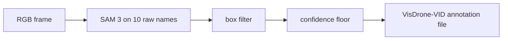

# Auto-labeler

The auto-labeler labels VisDrone-VID frames with boxes, without being trained on them. SAM 3,
prompted with VisDrone's 10 raw category names, finds boxes. The box filter drops the ones too
small, too large or duplicated. Auto-labels below the confidence floor are not kept. Its output
is VisDrone-VID annotation files, so [ingestion](data.md) builds a subset from them as it does
from VisDrone's own labels.

The labeling config comes from the labeling trials in
[tuning: auto-labeling VisDrone-VID](tuning/autolabel-visdrone-vid.md). The code is
`mlops_cv.autolabel` (`Labeler`, `annotation_lines`). Nothing in continuous training calls it yet.

## Settings

`AutolabelSettings`, at `settings.autolabel` (env `AUTOLABEL__…`, see [config](config.md)). The
defaults are the labeling trials' winner so far.

| Key | Default | What |
|---|---|---|
| `detector.model` | `facebook/sam3` | gated: `HF_TOKEN` in `.env`, run with `uv run --env-file .env` |
| `detector.prompts` | VisDrone's 10 raw names | prompt → the merged class its boxes get |
| `detector.threshold` | 0.001 | SAM 3's own floor; it keeps its top 300 boxes |
| `detector.dtype` | `float16` | `null` is fp32 |
| `box_filter.min_side` | 8 | px |
| `box_filter.max_area` | 0.05 | share of the frame |
| `box_filter.nms_iou` | 0.5 | class-agnostic NMS |
| `box_filter.min_score`, `nested_ios`, `max_objects` | off | a score floor, the nested-box rule, a top-K cap |
| `confidence_floor` | 0.597 | auto-labels below it are not kept |
| `max_det` | 300 | the top boxes kept per frame: val's cap, so trials score like val |

## Output

One `<sequence>.txt` per sequence, in VisDrone-VID's columns:
`frame, target_id, left, top, width, height, score, category, truncation, occlusion`.

- **`score`** is the auto-label's float confidence, always above 0. Ingestion skips only
  `score == 0` (ground truth's ignored regions), so it keeps every auto-label.
- **`category`** is the raw category the prompt names, so ingestion's 3-class merge applies
  unchanged. A prompt that names no raw category takes the lowest raw category of its merged class.
- **`target_id`** is the track id, or `-1` when no tracker ran.
- **`truncation`, `occlusion`** are `-1` (unknown).
