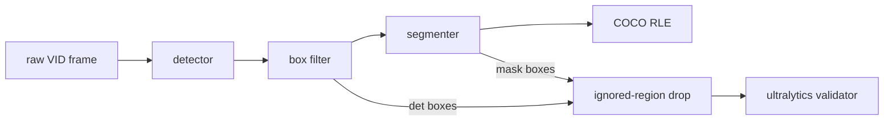
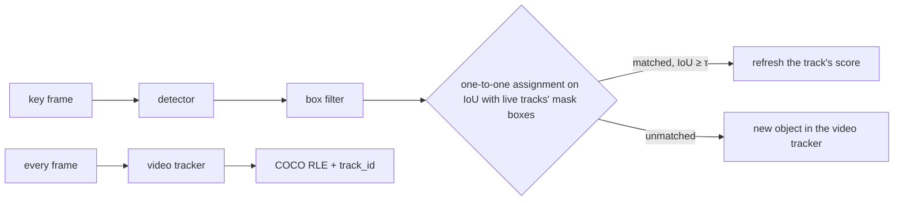
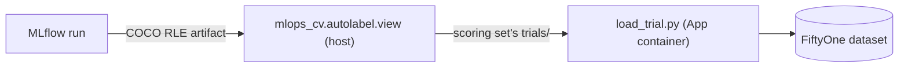

# Auto-labeling: zero-shot labels for VisDrone

How close a zero-shot auto-labeler (an open-vocabulary detector, a box filter, then a segmenter)
gets to VisDrone's ground truth, so a later effort can decide whether auto-labels seed or replace
human labels. Nothing is trained. Image mode labels single VisDrone-VID frames; its labeling
config is chosen by a staged grid of labeling trials, like [tuning](tuning.md), and the finalists
are read once on VID test-dev. VisDrone-DET isn't used: on the same frames it labels 1.6× VID's
objects, so a config tuned on it would fit the wrong labeling protocol.

## Scoring sets

| Set | Frames | Use |
|---|---|---|
| `train-sample` | 560: 10 evenly spaced from each of VID train's 56 sequences (48 recordings) | image-mode tuning; nothing is trained, so train is free to tune on |
| `val-stride20` | 146: every 20th VID val frame, the repo subset's val | the champion beside the image-mode finalists |
| `val-full` | 2,846: every frame of VID val's 7 sequences | sequence-mode tuning |
| `test-dev-full` | 6,635: every frame of VID test-dev's 17 sequences | the finalists, read once |

Each set's `ground_truth.json` carries VID's `track_id` per box.

## How a labeling trial works



- **Labeling config.** A stage YAML in `configs/autolabel/` lists trials, each a detector (a
  transformers repo or ultralytics YOLOE weights, and its prompts, each mapped to a merged
  class), the box filter, and a
  segmenter (a transformers SAM 2 or SAM 3 repo prompted with the kept boxes, `own` for SAM 3's
  own masks, or none). `defaults` sections are updated key by key.
  The detector keeps its top 300 boxes above 0.001, val's floor and cap, so the validator's
  threshold sweep sees everything. `confidence_floor`, the winning trial's max-F1 confidence,
  cuts the stored auto-labels; scoring reads every box.
- **Box filter.** Its stages run in order, each optional: min side, max share of the frame,
  min score, class-agnostic NMS, the nested-box rule, top K. Of two boxes nested at IoS ≥
  `nested_ios`, the rule keeps the outer one (`nested_keep: outer`), so a box drawn around a
  group deletes the objects inside it, or the inner one, deleting the group box.
- **Tiling.** Optional, on the detector (`tiling.side`): SAHI's slice grid at overlap 0.2 plus
  the full frame, each pass through the detector on its own. Zoom is the detector's input side
  over the slice side. Before the box filter the passes merge: boxes within 2 px of an interior
  slice edge are dropped (cut objects lie whole in a neighbouring slice or the full frame), then
  class-aware NMS at IoU 0.5. `merge: contained` swaps the edge rule for a larger-box-wins merge:
  after the NMS, a box ≥ 85% inside a larger one of its class joins it, which takes the pair's
  top score.
- **Stored detections.** A run over a whole scoring set stores the detector's boxes from before
  the merge and box filter in `<set>/detections/<hash of the detector settings>.npz`. A later
  trial with the same detector (the merge isn't part of the key) reads them and reruns only the
  merge, filter and segmenter, reporting the stored detector latency. The key ignores the
  detector code: delete the file after changing it.
- **Scores.** Two box sets per trial, `det` (the filtered detector boxes) and `seg` (each mask's
  tight box), both through `score_with_ap_small` at the 3 merged classes. **Selection is F1 at
  IoU 0.5**, from the validator's P and R at its max-F1 point, whose confidence is
  `<kind>/conf_at_max_F1`; mAP and per-class numbers are recorded only.
- **Ignored regions.** VisDrone's rule, not the repo's: see
  [Scoring convention](#scoring-convention-ignored-regions).
- **Capped rows.** SAM 3 returns at most 200 boxes per prompt, so every row is also scored on the
  frames where no raw category has more than 200 GT boxes (`<kind>/uncapped200/*`);
  `gt/cap200/recall_ceiling` is the recall left. Both sets' densest frames hold under 200 boxes in
  total, so for now the subset is every frame.
- **Latency.** Per stage (detector, filter, segmenter) and in total, decoded image to RLE, batch 1,
  the first 3 images left out.
- **Records.** One MLflow run per trial in `aerial-auto-label`, with the config as params and the
  auto-labels as `autolabels-<split>.json`: COCO, masks as compressed RLE, `bbox` the mask's box,
  `det_bbox` the detector's, and the prompt under `attributes.label`.
- **Champion row.** The champion YOLO26 runs through the same scoring as a supervised reference
  (boxes only, unfiltered). It trained on VID train, so the runner skips it on `train-sample`.

## Image-mode tuning grid

A staged greedy grid on `train-sample`, one or two factors per stage, the winner carried forward.
Before the segmenter stage, trials label boxes only and select on `det` F1. A challenger replaces
the carried config only when it wins by ≥ 0.5 pt F1 (a labeling trial has no noise floor);
latency is reported, never selects. Every stage keeps `min_side` 8 px and `max_area` 5% of the
frame, which drop almost no VID ground truth.

**Stage 1: box filter** (`configs/autolabel/box-filter.yaml`). Grounding DINO-T on the 10 raw
names at the new detector floor, no filter score floor. NMS IoU {off, 0.5, 0.6, 0.7} × the
nested-box rule {off, keep outer at IoS 0.8, keep inner at IoS 0.8}: 12 trials over one stored
detector pass. The incumbent is the smoke filter, NMS 0.6 with keep-outer 0.8 (`nms0.6-outer`).

```bash
uv run python -m mlops_cv.autolabel configs/autolabel/box-filter.yaml --set train-sample
```

`det` F1 at IoU 0.5 in %, with the confidence at the validator's max-F1 point and the boxes the
filter keeps per frame (the detector returns 300 on every frame; the ground truth holds 49).

| NMS IoU | Nested-box rule | det F1 | P | R | mAP50 | Max-F1 conf | Kept per frame |
|---|---|---|---|---|---|---|---|
| off | off | 56.7 | 55.9 | 57.6 | 52.9 | 0.193 | 287 |
| off | keep outer | 39.1 | 50.2 | 32.0 | 28.4 | 0.142 | 88 |
| off | keep inner | 35.1 | 30.4 | 41.6 | 27.8 | 0.080 | 147 |
| **0.5** | **off** | **58.0** | 57.9 | 58.0 | 52.8 | 0.184 | 205 |
| 0.5 | keep outer | 45.2 | 56.6 | 37.6 | 32.9 | 0.165 | 93 |
| 0.5 | keep inner | 47.3 | 53.0 | 42.7 | 38.7 | 0.158 | 142 |
| 0.6 | off | 57.8 | 57.2 | 58.4 | 53.5 | 0.187 | 228 |
| 0.6 | keep outer (incumbent) | 43.8 | 56.2 | 35.9 | 31.8 | 0.161 | 91 |
| 0.6 | keep inner | 46.1 | 52.1 | 41.3 | 37.6 | 0.155 | 145 |
| 0.7 | off | 57.4 | 56.8 | 58.1 | 53.5 | 0.190 | 247 |
| 0.7 | keep outer | 42.0 | 54.2 | 34.3 | 30.5 | 0.155 | 89 |
| 0.7 | keep inner | 45.6 | 51.8 | 40.7 | 37.4 | 0.153 | 146 |

- **Winner: NMS 0.5, no nested-box rule**, 14.2 pt over the incumbent. The labeling config
  carries `nms_iou: 0.5`, no `nested_ios`, and confidence floor 0.184. NMS 0.6 and 0.7 sit
  within 0.6 pt of it.
- **The floor was the bottleneck.** The smoke filter at the old floors (0.25, `min_score` 0.4)
  scored 29.6; the same filter at 0.001 scores 43.8, and dropping the nested-box rule 58.0.
- **The nested-box rule hurts in both directions.** It ignores scores, so without a score floor
  a low-scoring group box deletes the objects inside it (keep outer), and a low-scoring
  fragment deletes the object around it (keep inner).
- **Cost.** One detector pass (232 ms per frame, p50), then each filter setting rescores the
  stored boxes on CPU in about 3 min; the filter takes under 3 ms per frame.

**Stage 2: detector** (`configs/autolabel/detector.yaml`). Stage 1's filter (NMS 0.5) under
Grounding DINO-T and -B, OWLv2-B/16 (ensemble), YOLOE-26-L-seg (ultralytics) and SAM 3 end to
end, each with the 10 raw names and with plain nouns (person, car, van, truck, bus, bicycle,
motorcycle, tricycle), the better kept. Every detector keeps its top 300 boxes above 0.001; SAM 3
returns at most 200 per prompt. YOLOE runs at its native 640 and at 1280, since 640 halves a
VisDrone frame. The incumbent is stage 1's winner (`gdino-t-raw`). A larger size (OWLv2-L/14,
YOLOE-26-X) runs only if its smaller sibling wins.

```bash
uv run --env-file .env python -m mlops_cv.autolabel configs/autolabel/detector.yaml --set train-sample
```

`det` F1 at IoU 0.5 in %, with the boxes the filter keeps per frame and the detector's latency
(p50, RTX 5070 Laptop). The better prompt set per detector is in bold.

| Detector | Prompts | det F1 | P | R | mAP50 | Max-F1 conf | Kept per frame | Detector ms |
|---|---|---|---|---|---|---|---|---|
| GDINO-T (incumbent) | raw | 58.0 | 57.9 | 58.0 | 52.8 | 0.184 | 205 | 232 |
| GDINO-T | **nouns** | 58.8 | 60.4 | 57.2 | 52.3 | 0.279 | 220 | 236 |
| GDINO-B | **raw** | 60.7 | 64.0 | 57.6 | 54.6 | 0.203 | 203 | 329 |
| GDINO-B | nouns | 58.0 | 60.1 | 56.0 | 50.7 | 0.254 | 219 | 327 |
| OWLv2-B/16 | raw | 50.9 | 50.4 | 51.5 | 41.6 | 0.274 | 244 | 201 |
| OWLv2-B/16 | **nouns** | 54.3 | 54.8 | 53.8 | 45.8 | 0.271 | 243 | 201 |
| YOLOE-26-L @ 640 | raw | 45.4 | 63.8 | 35.2 | 39.8 | 0.053 | 160 | 19 |
| YOLOE-26-L @ 640 | **nouns** | 52.1 | 60.7 | 45.6 | 42.6 | 0.124 | 175 | 19 |
| YOLOE-26-L @ 1280 | raw | 54.5 | 60.8 | 49.4 | 48.7 | 0.054 | 174 | 56 |
| YOLOE-26-L @ 1280 | **nouns** | 58.2 | 60.3 | 56.2 | 50.0 | 0.197 | 185 | 57 |
| **SAM 3** | **raw** | **66.5** | 68.0 | 65.0 | 61.2 | 0.597 | 152 | 1,600 |
| SAM 3 | nouns | 65.7 | 66.9 | 64.6 | 60.4 | 0.564 | 166 | 1,428 |

- **Winner: SAM 3 end to end on the 10 raw names**, 8.5 pt over the incumbent and 5.8 over the
  runner-up, GDINO-B. The labeling config carries `detector.model: facebook/sam3` and confidence
  floor 0.597 (SAM 3's score is its query score times its presence score).
- **SAM 3's cap doesn't bind on the ground truth.** No `train-sample` frame holds more than 200
  boxes of one raw category (recall ceiling 1.0), so its uncapped-subset F1 is its full F1.
- **It is 7× slower.** 1.6 s per frame: one 1008² vision pass (≈ 0.7 s) plus a decoder pass per
  prompt (≈ 85 ms each), all in fp32. A SAM 3 trial labels `train-sample` in about 15 min, the
  others in 3 or less.
- **Plain nouns help the weaker detectors** (OWLv2 +3.4, YOLOE +3.7 to +6.7) and cost GDINO-B
  and SAM 3 0.8 to 2.7 pt.
- **YOLOE needs the resolution.** At 1280 it gains 6.1 pt over 640 and ties GDINO-T at a quarter
  of its latency. No smaller sibling won, so OWLv2-L/14 and YOLOE-26-X didn't run.

**Stage 3: prompts** (`configs/autolabel/prompts.yaml`). SAM 3 under stage 1's filter, with the
10 raw names (the incumbent, `sam3-raw`, rescored from its stored boxes) against the 3
merged-class names (`person`, `vehicle`, `two-three-wheeler`), each its own prompt. With 3
prompts SAM 3 returns at most 600 boxes before the top 300, and its 200-per-prompt cap now
covers a whole merged class.

```bash
uv run --env-file .env python -m mlops_cv.autolabel configs/autolabel/prompts.yaml --set train-sample
```

`det` F1 at IoU 0.5 in %, with mAP50-95 per merged class.

| Prompts | det F1 | P | R | mAP50 | Max-F1 conf | Kept per frame | Detector ms | person | vehicle | two-three-wheeler |
|---|---|---|---|---|---|---|---|---|---|---|
| **10 raw names (incumbent)** | **66.5** | 68.0 | 65.0 | 61.2 | 0.597 | 152 | 1,600 | 18.1 | 43.6 | 18.2 |
| 3 merged names | 45.4 | 45.0 | 45.9 | 43.8 | 0.589 | 217 | 995 | 17.9 | 41.7 | 0.0 |

- **Winner: the 10 raw names**, 21.1 pt over the merged names. The labeling config keeps
  stage 2's detector and confidence floor 0.597.
- **SAM 3 doesn't know `two-three-wheeler`.** It finds at most 4 boxes per frame above the
  max-F1 confidence, so the class scores 0; `person` and `vehicle` lose under 2 pt mAP50-95.
- **The cap still doesn't bind.** No frame holds more than 121 GT boxes of one merged class.
  `person` and `vehicle` fill all 200 queries above the 0.001 floor, but at most 86 per frame
  clear the max-F1 confidence.
- **Fewer prompts are cheaper**: 3 decoder passes take SAM 3 to 995 ms per frame, from 1,600.

**Stage 4: tiling** (`configs/autolabel/tiling.yaml`). SAM 3 on the 10 raw names under stage 1's
filter, untiled (the incumbent, rescored from the fp16 parity check's stored boxes) against
slices plus the full frame at zoom 1.25 (806 px slices) and 2 (504 px), merged by the edge rule,
and at 1.25 with the contained merge (a CPU rescore of 1.25's stored passes). SAM 3 squashes
every pass to a 1008 square, so a full `train-sample` frame (1344 to 2720 px wide) runs at 0.37×
to 0.75× horizontally.
A frame takes 7.5 passes on average at 1.25 and 17.5 at 2, and batching an image's slices gains
nothing (SAM 3 is compute-bound).

**SAM 3 runs in fp16 from this stage on** (`detector.dtype: float16`): 484 ms per pass against
fp32's 1.6 s. Parity on the untiled row, against fp32's `det` F1 66.5:

| Untiled SAM 3 | det F1 | mAP50-95 small | Box shift from fp32, median / p90 | Detector ms |
|---|---|---|---|---|
| fp32 | 66.5 | 10.8 | — | 1,600 |
| **fp16** | **66.3** | 10.7 | 0.2 / 0.7 px | 484 |
| bf16 | 62.6 | 7.4 | 1.4 / 4.7 px | 480 |

bf16's 8-bit mantissa moves boxes enough to cost small objects their IoU match; fp16 stays
within 0.5 pt.

```bash
uv run --env-file .env python -m mlops_cv.autolabel configs/autolabel/tiling.yaml --set train-sample
```

`det` F1 at IoU 0.5 in %, fp16, with mAP50-95 per merged class. Detector ms is the p50 per frame,
all passes included.

| Tiling | det F1 | P | R | mAP50 | mAP50-95 | small | Max-F1 conf | Kept per frame | Detector ms | person | vehicle | two-three-wheeler |
|---|---|---|---|---|---|---|---|---|---|---|---|---|
| **untiled (incumbent)** | **66.3** | 67.9 | 64.8 | 60.9 | 26.6 | 10.7 | 0.597 | 151 | 484 | 18.0 | 43.6 | 18.1 |
| zoom 1.25, edge | 65.5 | 64.7 | 66.2 | 61.3 | 27.0 | 9.0 | 0.737 | 529 | 3,389 | 17.9 | 45.2 | 18.0 |
| zoom 1.25, contained | 44.8 | 53.8 | 38.4 | 31.2 | 13.9 | 7.3 | 0.674 | 177 | 3,389 | 4.2 | 25.6 | 11.8 |
| zoom 2, edge | 64.4 | 62.7 | 66.3 | 60.0 | 26.4 | 8.2 | 0.756 | 1,147 | 7,769 | 17.5 | 44.3 | 17.3 |

- **Winner: untiled**, the incumbent; no tiled row comes within the 0.5 pt margin. The labeling
  config keeps stage 3's detector, now in fp16, and confidence floor 0.597.
- **Tiling trades precision for recall.** Slices add 1.4 to 1.5 pt of recall but cost 3 to 5 pt
  of precision, and mAP50-95 small falls (10.7 to 9.0 and 8.2): the extra boxes add confident
  false positives, which push the max-F1 confidence from 0.60 to 0.74–0.76.
- **The contained merge collapses** because it runs on every box down to the 0.001 floor: 93% of
  the confident boxes it absorbs go into a lower-scoring box, 86% into one over 5% of the frame
  that the box filter then drops.
- **Tiling costs 7× (1.25) to 16× (2)** SAM 3's untiled time; the merge adds ≤ 14 ms.

**Stage 5: box filter recheck** (`configs/autolabel/box-filter-recheck.yaml`). Stage 1's 12
settings, NMS IoU {off, 0.5, 0.6, 0.7} × the nested-box rule {off, keep outer at IoS 0.8, keep
inner at IoS 0.8}, on stage 4's winner (SAM 3, 10 raw names, untiled, fp16), each a CPU rescore of
its stored boxes. The incumbent is the carried filter, NMS 0.5 with no nested-box rule
(`nms0.5-nested-off`). The winner's max-F1 confidence is the labeling config's confidence floor
for the segmenter stage and sequence mode.

```bash
uv run python -m mlops_cv.autolabel configs/autolabel/box-filter-recheck.yaml --set train-sample
```

`det` F1 at IoU 0.5 in %, with mAP50-95 per merged class (the detector keeps its top 300 boxes
on every frame).

| NMS IoU | Nested-box rule | det F1 | P | R | mAP50 | Max-F1 conf | Kept per frame | person | vehicle | two-three-wheeler |
|---|---|---|---|---|---|---|---|---|---|---|
| off | off | 65.1 | 66.1 | 64.1 | 62.0 | 0.626 | 274 | 18.2 | 43.9 | 19.2 |
| off | keep outer | 55.8 | 60.8 | 51.6 | 52.5 | 0.409 | 120 | 13.6 | 41.1 | 14.5 |
| off | keep inner | 49.0 | 60.2 | 41.4 | 42.6 | 0.517 | 138 | 12.7 | 36.8 | 6.4 |
| **0.5** | **off (incumbent)** | **66.3** | 67.9 | 64.8 | 60.9 | **0.597** | 151 | 18.0 | 43.6 | 18.1 |
| 0.5 | keep outer | 65.8 | 68.4 | 63.4 | 59.0 | 0.585 | 119 | 16.5 | 43.5 | 17.9 |
| 0.5 | keep inner | 57.8 | 64.6 | 52.3 | 48.8 | 0.585 | 130 | 15.5 | 40.1 | 8.9 |
| 0.6 | off | 66.5 | 67.8 | 65.3 | 61.6 | 0.597 | 167 | 18.2 | 43.7 | 18.6 |
| 0.6 | keep outer | 65.6 | 68.4 | 63.0 | 59.0 | 0.580 | 121 | 16.3 | 43.5 | 18.0 |
| 0.6 | keep inner | 56.9 | 64.4 | 50.9 | 47.9 | 0.582 | 135 | 15.1 | 39.8 | 8.5 |
| 0.7 | off | 66.7 | 67.7 | 65.6 | 62.2 | 0.598 | 184 | 18.3 | 43.8 | 19.0 |
| 0.7 | keep outer | 64.9 | 68.2 | 61.9 | 58.3 | 0.571 | 121 | 15.8 | 43.5 | 17.9 |
| 0.7 | keep inner | 55.9 | 64.2 | 49.5 | 46.9 | 0.579 | 137 | 14.7 | 39.8 | 7.9 |

- **Winner: the incumbent, NMS 0.5 with no nested-box rule.** NMS 0.7 and 0.6 gain 0.3 and
  0.2 pt, inside the margin. The labeling config keeps stage 4's detector and filter, and its
  **confidence floor is 0.597**, rechecked here, for the segmenter stage and sequence mode.
- **The nested-box rule costs SAM 3 less than Grounding DINO-T** (keep outer −0.5 pt at NMS 0.5,
  against −12.8); keep inner still loses 8 to 11 pt, two-three-wheeler mAP50-95 falling by half.
- **Cost.** All 12 settings rescore on CPU in under 2 min; the filter takes under 3 ms per frame.

**Stage 6: segmenter** (`configs/autolabel/segmenter.yaml`). Stage 5's winner (SAM 3, 10 raw
names, untiled, fp16, NMS 0.5) with SAM 2.1 S (the incumbent, the smoke's) and L, SAM 3's tracker
prompted with the kept boxes (`segmenter: facebook/sam3`, `Sam3TrackerModel`), and SAM 3's own
masks for its kept boxes (`segmenter: own`: the detector's mask probabilities upsampled to the
frame and cut at 0.5, as its processor does). Segmenters run in fp32. Own masks rerun the
detector, since the stored boxes carry no masks; the others read the store. Selection is on `seg`
F1; every trial's stored auto-labels are cut at the confidence floor 0.597.

```bash
uv run --env-file .env python -m mlops_cv.autolabel configs/autolabel/segmenter.yaml --set train-sample
```

`seg` F1 at IoU 0.5 in %, scored on each mask's tight box (`det` F1 is 66.3 in every row), with
the segmenter's latency (p50 per frame, ≈ 151 kept boxes, RLE encoding included) and the stored
auto-labels cut at 0.597.

| Segmenter | seg F1 | P | R | mAP50 | mAP50-95 | small | Max-F1 conf | Segmenter ms | Total ms | Auto-labels MB |
|---|---|---|---|---|---|---|---|---|---|---|
| **SAM 2.1 S (incumbent)** | **66.4** | 68.0 | 65.0 | 61.1 | 26.8 | 11.6 | 0.597 | 629 | 1,111 | 12.5 |
| SAM 2.1 L | 66.2 | 67.8 | 64.8 | 60.8 | 26.6 | 11.2 | 0.597 | 841 | 1,323 | 12.4 |
| SAM 3 tracker | 65.3 | 67.1 | 63.6 | 59.7 | 26.0 | 10.5 | 0.601 | 1,321 | 1,807 | 12.5 |
| SAM 3 own masks | 64.4 | 65.7 | 63.2 | 57.9 | 25.3 | 10.2 | 0.594 | 285 | 766 | 12.6 |

- **Winner: SAM 2.1 S, the incumbent.** No challenger beats it; SAM 2.1 L is 0.2 pt behind at
  1.3× its time. The labeling config carries `segmenter: facebook/sam2.1-hiera-small` and
  confidence floor 0.597 (the `seg` max-F1 confidence matches `det`'s).
- **SAM 2.1's masks fit the boxes best.** Its mask boxes score 0.1 pt above the detector's own
  boxes and lift mAP50-95 small from 10.7 to 11.6; SAM 3's tracker loses 1 pt, its own masks 1.9.
- **SAM 3's own masks are coarse**: one 288² map per box for the whole frame, upsampled 5 to 9×,
  which costs small objects their tight box.
- **Cost.** Own masks cost only their upsample and RLE (285 ms); SAM 2.1 adds its encoder and
  decoder, and the SAM 3 tracker reruns a 1008² vision pass in fp32. The stage ran in 37 min.

**GT-box check** (reported only, never selects). Each box-prompted segmenter (SAM 2.1 S, SAM 2.1 L,
SAM 3's tracker) prompted with the ground-truth boxes of `train-sample` (after the ignored-region
rule), which takes the detector out of its masks. Box fit: each mask's tight box against the GT
box that prompted it, as the mean box IoU and F1 at IoU 0.5 and 0.75 (an empty mask is a miss).
Mask IoU: against [AeroVIS](https://arxiv.org/abs/2607.08075)'s hand-reviewed masks, on the 460
`train-sample` frames it holds byte for byte (46 of VID train's 56 sequences, VID's own boxes and
track ids, matched by track id). AeroVIS's masks were made by SAM 3 from these boxes, so the
SAM 3 row is circular. SAM 3's own masks have no box prompt, so they can't take part. AeroVIS's
annotations are non-commercial: keep them local, never in the repo.

```bash
uv run --env-file .env python -m mlops_cv.autolabel.gt_box_check --set train-sample \
  --aerovis <local AeroVIS folder>
```

In %, over `train-sample`'s 27,339 scored GT boxes; the mask IoU over the 23,415 of them that
AeroVIS masks. The AeroVIS row is its own masks' tight boxes against the same VID boxes, on its
460 frames: the fit a hand-reviewed mask reaches.

| Segmenter (GT boxes in) | Mean box IoU | F1 @ IoU 0.5 | F1 @ IoU 0.75 | Mask IoU vs AeroVIS |
|---|---|---|---|---|
| SAM 2.1 S | 76.4 | 97.7 | 60.2 | 83.4 |
| SAM 2.1 L | 75.6 | 97.0 | 56.9 | 83.7 |
| SAM 3 tracker | 75.5 | 97.1 | 56.2 | 89.2 (circular) |
| AeroVIS masks (reference) | 82.4 | 98.4 | 76.9 | — |

- **Given the right box, every segmenter keeps it at IoU 0.5** (97–98%, ≤ 2 empty masks), so
  the `seg` scores above are bound by the detector, not the masks. At IoU 0.75 SAM 2.1 S fits
  best, as its `seg` row did, but all three trail the reviewed masks by 17–21 pt.
- **SAM 2.1 S and L agree with AeroVIS equally** (83.4 vs 83.7). SAM 3's 89.2 caps what review
  changed: part of its 10.8 pt gap is pipeline, since AeroVIS also clips its masks to the box.

## Sequence mode

A trial with a `tracker` section labels whole sequences (`val-full`, `test-dev-full`), so
objects keep one id across frames and the detector runs only on key frames.



- **Video trackers** (EdgeTAM, SAM 2.1 video, through transformers). Frame 0 and every K-th
  frame are key frames (`key_interval`). Kept boxes are assigned one-to-one to the live tracks'
  mask boxes on IoU ≥ τ (`new_iou`, 0.3), as SORT, ByteTrack and BoT-SORT match; every box left
  unmatched starts a track. The tracker is never reset; its memory is
  pruned to each object's seed frame plus the last 16 frames, which keeps it flat. A track ends
  after 25 empty-mask frames (`empty_frames`) or 2 key frames without a match
  (`unmatched_keys`, the drift rule); of two tracks whose masks overlap at IoU > 0.8
  (`duplicate_iou`), the younger ends. A tracked frame carries the score of the last detection
  its track matched. `max_objects` caps live tracks; none by default.
- **Confidence floor on key frames.** With `confidence_floor`, only kept boxes at or above it
  start or refresh a track; `det` still scores every kept box.
- **Stored key-frame boxes.** A video trial reads its key frames' detector boxes from the set's
  stored detections when they exist, so every trial over one detector shares one pass. Its
  detector latency is then the stored ms per key frame, amortised over the frames.
- **Box-tracker controls** (`botsort`, `bytetrack`: ultralytics' default settings, except
  `track_high_thresh` and `new_track_thresh`, which take the confidence floor: their 0.25 is
  YOLO's score scale). The detector, box filter and segmenter run on every frame, once per
  stage: both controls reuse that pass. A detection is an auto-label when the tracker gives it a
  track.
- **Scores.** `det` scores the filtered detector boxes on key frames only, and `seg` every frame's
  auto-label boxes. Tracks go through TrackEval's MOTChallenge adapter
  (`trackeval==1.3.0`, a numpy-2 fork of upstream), once per merged class after the
  ignored-region rule, combined det-averaged: `track/HOTA` (DetA, AssA), `track/IDF1`,
  `track/MOTA`, `track/IDSW`, and per class. Stages that tune tracking settings select on HOTA,
  the rest on F1. The 3 merged classes aren't VisDrone-MOT's 5, so these numbers don't compare
  with published ones.
- **Records.** `latency/<stage>/amortised_ms`: each stage's (detector, filter, segmenter,
  tracker) total over the frames divided by the frame count, the first key-frame cycle left out
  as warm-up. `tracks/peak_live` is the most live tracks on any frame. The COCO file adds a
  `track_id` per auto-label; `det_bbox` appears only where a detection matched it.

## Sequence-mode tuning grid

A staged greedy grid on `val-full` (all 7 VID val sequences, 2,846 frames) over image mode's
labeling config: SAM 3 fp16 on the 10 raw names, untiled, the box filter, confidence floor 0.597.
The detector's pass is stored once and read by every trial. F1 stages select on `seg` max-F1
(`det` sees key frames only), tracking-settings stages on `track/HOTA`; a challenger wins by
≥ 0.5 pt, latency is reported only.

**Stage 1: key-frame interval** (`configs/autolabel/key-interval.yaml`). EdgeTAM video at K
{5, 10, 20}, incumbent 10, the floor on key frames. First, the image-mode reference row (the
stored pass, the box filter and SAM 2.1 S on every frame, no tracking; reported only), which
writes the stored pass.

```bash
uv run --env-file .env python -m mlops_cv.autolabel configs/autolabel/key-interval.yaml --set val-full
```

In %; `det` F1 is the key frames' (every frame for the reference row), latency amortised per
frame (the reference row's is its mean), RTX 5070 Laptop.

| Trial | seg F1 | P | R | mAP50-95 | det F1 | HOTA | IDF1 | MOTA | ID switches | Peak live | ms (detector + tracker) | MB |
|---|---|---|---|---|---|---|---|---|---|---|---|---|
| Image mode, no tracking (reference) | 61.6 | 62.7 | 60.5 | 24.3 | 61.2 | — | — | — | — | — | 1,724 (479 + SAM 2.1 S 1,244) | 49.9 |
| **K = 5** | **53.2** | 53.3 | 53.2 | 17.3 | 61.0 | 39.9 | 46.0 | 5.0 | 1,307 | 150 | 615 (96 + 519) | 52.3 |
| K = 10 (incumbent) | 52.2 | 51.6 | 52.8 | 16.9 | 61.0 | 40.8 | 48.2 | 4.2 | 922 | 155 | 579 (49 + 530) | 51.7 |
| K = 20 | 51.5 | 51.1 | 51.8 | 16.2 | 61.1 | 40.8 | 48.5 | 3.1 | 666 | 160 | 565 (25 + 540) | 50.6 |

Per sequence, F1 in %: `det` is the stored pass and box filter on every frame (uncut), `seg` the
stored auto-labels (cut at 0.597).

| Sequence | Frames | GT per frame | det | Reference seg | K = 5 seg | K = 10 seg | K = 20 seg |
|---|---|---|---|---|---|---|---|
| uav0000086_00000_v | 464 | 49.6 | 76.3 | 75.0 | 63.5 | 57.7 | 57.3 |
| uav0000117_02622_v | 349 | 46.8 | 65.3 | 65.8 | 56.8 | 54.8 | 54.4 |
| uav0000137_00458_v | 233 | 103.1 | 68.0 | 67.5 | 57.1 | 56.2 | 55.0 |
| uav0000182_00000_v | 363 | 48.5 | 50.4 | 51.9 | 44.7 | 43.9 | 43.5 |
| **uav0000268_05773_v** (3840×2160) | 978 | 13.9 | 43.9 | 29.7 | 23.2 | 22.9 | 23.8 |
| uav0000305_00000_v | 184 | 34.7 | 51.9 | 53.8 | 43.7 | 43.8 | 43.4 |
| uav0000339_00001_v | 275 | 43.5 | 68.6 | 68.2 | 64.7 | 63.9 | 62.1 |

- **Winner: K = 5**, 1.0 pt over the incumbent K = 10; K = 20 loses 0.7. Sequence mode carries
  `key_interval: 5` to the tracker-model stage.
- **Tracking costs 8–10 pt of `seg` F1 against labeling every frame**, on every sequence: P and R
  both drop, and mAP50-95 falls 7 pt, so EdgeTAM's masks between key frames fit worse than SAM 2.1
  S's on fresh boxes. More key frames recover only part of it; HOTA and IDF1 run the other way
  (K = 5 switches ids twice as often as K = 20). MOTA ≈ 3–5%: false
  positives nearly cancel the matches.
- **The 4K sequence is floor-bound.** The detector reaches `det` F1 43.9 there, but cutting at
  0.597 leaves 17.9% recall (P 87.4) even without tracking: SAM 3 scores distant small objects
  lower than the floor measured on `train-sample`. Its peak is 12 live tracks.
- **Cost.** The tracker dominates and barely moves with K; the dense `uav0000137_00458_v` peaks at
  155 live tracks and 1.8 s per frame (3.9 GB GPU over its first 100 frames, SAM 3 loaded). Each
  K row took 26 min, the reference row 84 min (it wrote the stored pass).

**Stage 2: tracker model** (`configs/autolabel/tracker-model.yaml`). At K = 5: EdgeTAM video (the
incumbent, stage 1's K = 5 run, same config), SAM 2.1 S video (L lost image mode), and the
BoT-SORT and ByteTrack controls as contenders, sharing one pass of the stored detector boxes, the
box filter and SAM 2.1 S on every frame. Selects on `seg` max-F1; HOTA, IDF1, MOTA and ID switches
reported. SAM 2.1 S video runs on the whole set only if a 100-frame probe on the densest sequence
projects the stage inside its budget (3 h); otherwise the probe is its row.

```bash
# expandable segments: SAM 2.1 S video at 145 live tracks otherwise runs out of memory (fragmentation)
PYTORCH_CUDA_ALLOC_CONF=expandable_segments:True uv run --env-file .env \
  python -m mlops_cv.autolabel configs/autolabel/tracker-model.yaml --set val-full
```

In %; `det` F1 is the key frames' for the video trackers and every frame's for the controls;
latency amortised per frame. A control's peak live counts lost tracks too (kept 30 frames).

| Trial | seg F1 | P | R | mAP50-95 | det F1 | HOTA | DetA | AssA | IDF1 | MOTA | ID switches | Peak live | ms (detector + segmenter + tracker) | MB |
|---|---|---|---|---|---|---|---|---|---|---|---|---|---|---|
| **BoT-SORT + SAM 2.1 S** | **61.3** | 61.9 | 60.8 | 21.6 | 61.2 | 47.8 | 38.3 | 62.0 | 60.7 | 27.1 | 394 | 194 | 1,766 (479 + 1,261 + 26) | 51.6 |
| ByteTrack + SAM 2.1 S | 61.0 | 64.1 | 58.3 | 21.6 | 61.2 | 44.1 | 38.0 | 54.0 | 53.6 | 28.4 | 1,481 | 374 | 1,742 (479 + 1,261 + 2) | 48.1 |
| SAM 2.1 S video | 56.4 | 55.9 | 56.9 | 20.7 | 61.0 | 44.8 | 36.4 | 58.2 | 52.3 | 14.0 | 521 | 145 | 1,609 (96 + 1,513) | 48.9 |
| EdgeTAM video (incumbent) | 53.2 | 53.3 | 53.2 | 17.3 | 61.0 | 39.9 | 33.6 | 49.9 | 46.0 | 5.0 | 1,307 | 150 | 615 (96 + 519) | 52.3 |

| Sequence | Reference seg | BoT-SORT | ByteTrack | SAM 2.1 S video | EdgeTAM |
|---|---|---|---|---|---|
| uav0000086_00000_v | 75.0 | 73.8 | 74.4 | 67.6 | 63.5 |
| uav0000117_02622_v | 65.8 | 65.5 | 65.5 | 61.5 | 56.8 |
| uav0000137_00458_v | 67.5 | 67.0 | 65.9 | 61.7 | 57.1 |
| uav0000182_00000_v | 51.9 | 51.4 | 50.6 | 47.4 | 44.7 |
| uav0000268_05773_v (3840×2160) | 29.7 | 29.2 | 29.3 | 24.2 | 23.2 |
| uav0000305_00000_v | 53.8 | 53.3 | 50.8 | 47.3 | 43.7 |
| uav0000339_00001_v | 68.2 | 67.4 | 67.4 | 64.9 | 64.7 |

- **Winner: BoT-SORT + SAM 2.1 S**, 8.1 pt over EdgeTAM; ByteTrack is 0.3 pt behind (inside the
  margin) but loses 3.7 pt HOTA and switches ids almost 4× as often. A control won, so the
  tracking-settings stage only views; the confidence-floor stage moves BoT-SORT's track thresholds.
- **The box trackers keep image mode's quality and add ids**: within 1.4 pt of the reference row on
  every sequence. SAM 2.1 S video recovers 3.2 pt over EdgeTAM and halves its ID switches, but its
  masks still drift between key frames.
- **No latency win.** The controls run the detector and segmenter on every frame (1.77 s/frame,
  as image mode); SAM 2.1 S video costs 1.6 s/frame (4.6 s on the dense sequence at 140 live
  tracks, 6.4 GB allocated), EdgeTAM 0.6 s. Wall-clock: both controls 65 min, SAM 2.1 S video
  73 min.

## Scoring convention: ignored regions

**These numbers are not comparable with [tuning](tuning.md) or [evaluation](evaluation.md).** The
evaluator is the same (`score_with_ap_small`, ultralytics' validator), but the boxes fed to it
differ:

| | Repo (training, tuning, evaluation) | Auto-labeling |
|---|---|---|
| Ignored-region rows | deleted from the labels | kept, as each frame's ignored regions |
| Ground truth inside them | kept | dropped when ≥ half its area is inside their union |
| Predictions inside them | kept, so a hit on an unlabeled object is a false positive | dropped by the same rule |

Ignored regions are crowds and distant traffic the annotators left unlabeled. The champion learned
from those labels not to fire there, while a zero-shot detector never did, so the repo's
convention would charge it false positives for real objects and tune the box filter to copy the
annotators' gaps. VisDrone's own toolkit drops both sides, and the auto-labeler follows it.

The gap grows with the boxes a row keeps. The smoke trial keeps about 13 per frame: the rule drops
1.3% of `train-sample`'s ground truth (357 of 27,696) and 1.5% of its auto-labels, and moves its
F1 by 0.3 pt. The champion keeps boxes down to confidence 0.001: 12% of them fall in ignored
regions, and the rule lifts its `val-stride20` F1 from 67.6 to 69.6. The champion is re-scored here
under the same rule, so the rows in [Results](#results) compare with each other, never with its
numbers elsewhere.

## Commands

`.env` sets `DATA__RAW_DIR` (raw VisDrone-VID) and `DATA__AUTOLABEL_DIR` (the scoring sets).

```bash
# The scoring sets: frame links, YOLO labels, data.yaml, COCO ground truth + ignored regions.
uv run python -m mlops_cv.autolabel.visdrone_vid
# One stage on one set; --limit N labels and scores only the first N frames.
uv run python -m mlops_cv.autolabel configs/autolabel/smoke.yaml --set train-sample
uv run python -m mlops_cv.autolabel configs/autolabel/smoke.yaml --set val-stride20
# Sequence mode on whole sequences; --sequence NAME (repeatable) keeps only those.
uv run --env-file .env python -m mlops_cv.autolabel configs/autolabel/sequence-smoke.yaml \
  --set val-full --sequence uav0000305_00000_v
```

## Viewing a trial

The annotation editor is FiftyOne 1.22.1 (`docker-compose/docker-compose.fiftyone.yml`): the App
and its MongoDB, with raw VID and the scoring sets mounted read-only at their host paths.

```bash
make fiftyone-up                       # http://localhost:5151
make autolabel-view RUN=<MLflow run id> # a run in aerial-auto-label
```



- **Datasets.** One FiftyOne dataset per scoring set, `visdrone-vid-<set>`, created on first load
  with `ground_truth` (after the ignored-region drop) and `ignored`.
- **Fields.** Each trial adds `<run>_seg` (mask and its tight box) and `<run>_det` (the detector's
  box), named by its run name without the set suffix; the champion row has only `_det`. Reloading
  overwrites them. Auto-labels are shown as stored, before the ignored-region drop.
- **Flags are for browsing only.** Each field gets `evaluate_detections` at IoU 0.5
  (`eval_<field>`), for TP/FP/FN filters in the App. They count every confidence and match
  unlike the validator, so the numbers above come from `score_with_ap_small` alone.
- **Masks.** Settings' *Label opacity* fades mask fills only; at 0 the boxes stay.
- **Loading takes time.** The flags dominate: `train-sample` with one trial loads in 2.3 min,
  the champion's 0.001-floor row on `val-stride20` in 4.6 min, a sequence-mode trial on
  `val-full` in 14 min (3.1 GB in the App container). `_det` holds only the key frames' matched detector boxes.
- **Masks are copied out of the frame.** FiftyOne 1.22.1 crops each decoded mask as a view of
  the whole frame, which held every 4K frame in memory (24 GB, killed); the loader copies the
  crop.

## Results

**Image-mode finalists** (`configs/autolabel/finalists.yaml`) on `val-stride20` (146 frames, never
tuned on): the smoke chain (GDINO-T at its 0.25 floor → the smoke box filter → SAM 2.1 S) and the
grid's winner, the image-mode labeling config (`configs/autolabel/image-mode.yaml`), beside the
champion YOLO26m@1280 (boxes only, unfiltered). The winner also reads P, R and F1 at its
confidence floor, off the validator's curves (`<kind>/at_floor/*`).

```bash
uv run --env-file .env python -m mlops_cv.autolabel configs/autolabel/finalists.yaml --set val-stride20
```

In %, under the [auto-labeling scoring convention](#scoring-convention-ignored-regions); latency
p50 per frame (RTX 5070 Laptop).

| Trial | Box | F1 | P | R | mAP50 | mAP50-95 | small | person | vehicle | two-three-wheeler | Max-F1 conf | F1 at 0.597 | ms |
|---|---|---|---|---|---|---|---|---|---|---|---|---|---|
| Smoke: GDINO-T → SAM 2.1 S | det | 28.8 | 84.2 | 17.4 | 16.5 | 10.2 | 1.0 | 0.8 | 24.3 | 5.4 | ≤ 0.40 | — | 341 |
| | seg | 28.5 | 82.3 | 17.2 | 16.4 | 9.2 | 1.2 | 0.7 | 22.6 | 4.3 | | | |
| **Image mode: SAM 3 → SAM 2.1 S** | det | 61.1 | 61.7 | 60.6 | 55.2 | 23.9 | 9.1 | 21.6 | 38.4 | 11.8 | 0.600 | 61.1 | 1,665 |
| | seg | **61.8** | 62.6 | 61.0 | 55.8 | 24.2 | 9.5 | 21.6 | 39.4 | 11.6 | 0.604 | 61.7 | |
| Champion YOLO26m@1280 (reference) | det | 69.6 | 77.1 | 63.4 | 67.6 | 34.4 | 16.2 | 31.3 | 45.1 | 26.8 | 0.256 | — | 27 |

- **The image-mode labeling config** (`configs/autolabel/image-mode.yaml`): SAM 3 end to end on
  the 10 raw VisDrone names, untiled, fp16 → box filter (min side 8 px, ≤ 5% of the frame,
  NMS 0.5) → SAM 2.1 S, auto-labels cut at confidence 0.597. It scores `seg` F1 66.4 on
  `train-sample` and 61.8 here, 33 pt over the smoke chain and 7.8 pt under the champion, which
  trained on VID's labels.
- **The confidence floor transfers.** The max-F1 confidence here is 0.600 (`det`) and 0.604
  (`seg`), against 0.597 on `train-sample`; cutting at 0.597 costs 0.1 pt.
- **The gap to the champion is precision and small objects.** Recall is within 2.4 pt; precision
  is 14.5 pt lower, mAP50-95 small 9.5 against 16.2, and two-three-wheelers score under half the
  champion's mAP50-95. The masks add 0.7 pt over the detector's own boxes.
- **Cost.** 1.7 s per frame: SAM 3 0.48 s, SAM 2.1 S 1.2 s over ≈ 158 kept boxes (more and
  larger frames than `train-sample`'s 0.63 s: one sequence is 3840×2160). The smoke chain's
  floors make it recall-bound (17%), and its F1 curve is flat below its 0.4 score filter.

**Sequence-mode smoke** (`val-full`, one sequence: `uav0000305_00000_v`, 184 frames, 35
ground-truth boxes per frame). The smoke chain on key frames; F1 and HOTA in %.

| Trial | det F1 | seg F1 | HOTA | IDF1 | ID switches | Peak live tracks | ms per frame |
|---|---|---|---|---|---|---|---|
| EdgeTAM video, K = 10 | 22.5 | 19.8 | 35.1 | 38.5 | 52 | 24 | 200 |
| BoT-SORT + SAM 2.1 S (control) | 25.4 | 22.5 | 41.5 | 50.0 | 18 | 40 | 392 |
| ByteTrack + SAM 2.1 S (control) | 25.4 | 20.5 | 38.2 | 46.9 | 12 | 34 | 381 |

- **Recall-bound, like image mode.** The smoke filter finds almost no persons or
  two-three-wheelers here (mAP 0.0 for both), so their tracks score 0.
- **Cost.** A VID val pass (2,846 frames) at these rates takes about 10 min for EdgeTAM and
  19 min for both controls, which share one detection pass. EdgeTAM costs about 8 ms more per
  live track, so more recall makes it slower.
- **EdgeTAM switches ids more.** 52 against BoT-SORT's 18. The key-frame matching is not the
  cause: greedy and one-to-one matching score the same (51 and 52 switches) at 14 kept boxes per
  frame.
