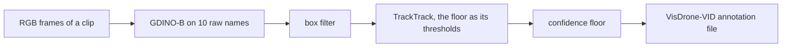

# Auto-labeler

The auto-labeler labels VisDrone-VID clips with boxes and tracks, without being trained on them.
Grounding DINO B (GDINO-B), prompted with VisDrone's 10 raw category names, finds boxes in each
frame. The box filter drops the ones too small, too large or duplicated. TrackTrack, a fresh one
per clip, links the kept boxes into tracks; the confidence floor is its threshold for a box to
match or start a track, and auto-labels below it are not kept. Its output is VisDrone-VID
annotation files, so [ingestion](data.md) builds a subset from them as it does from VisDrone's own
labels.



The labeling config comes from the labeling trials in
[tuning: auto-labeling VisDrone-VID](tuning/autolabel-visdrone-vid.md). GDINO-B won on train
(0.4 pt behind SAM 3, inside the margin, at 2.4× its speed) and leads SAM 3 on val by 3.7 pt
mAP50-95. TrackTrack beat BoT-SORT on the train clips (48.8 vs 47.1 HOTA) and held on val (48.0 vs
46.7). The code is `mlops_cv.autolabel` (`Labeler`, `label_clip`, `annotation_lines`); the labeling
trials track through the same code. Nothing in continuous training calls it yet.

## Run it and view it in FiftyOne

`python -m mlops_cv.autolabel <sequence dir>...` labels each VisDrone-VID `sequences/<seq>/`
folder (frames `0000001.jpg` on, no gaps) and writes `<seq>.txt` to `--out`, by default
`<runs_dir>/labeler/annotations/` (`runs/autolabel/labeler/annotations/`). GDINO-B takes about a minute for a 200-frame sequence on
the 8 GB GPU.

1. Pick sequences of a raw split, for example val's:

   ```bash
   RAW=$(uv run python -c "from mlops_cv.config import get_settings as s; print(s().data.raw_dir.resolve())")
   ls $RAW/VisDrone2019-VID-val/sequences
   ```

2. Label them:

   ```bash
   uv run python -m mlops_cv.autolabel \
     $RAW/VisDrone2019-VID-val/sequences/uav0000305_00000_v \
     $RAW/VisDrone2019-VID-val/sequences/uav0000137_00458_v
   ```

3. Start the annotation editor (FiftyOne, `docker-compose/docker-compose.fiftyone.yml`). It mounts
   the raw split and `runs_dir` read-only at their host paths:

   ```bash
   make fiftyone-up   # the App on http://localhost:5151
   ```

4. Load the auto-labels beside the split's ground truth:

   ```bash
   docker exec fiftyone python /opt/load_trial.py $RAW/VisDrone2019-VID-val $PWD/runs/autolabel/labeler/annotations
   ```

5. Open http://localhost:5151 and the dataset `visdrone-vid-val`:
   - `ground_truth` holds VisDrone's boxes and `ignored` its ignored regions (crowds and distant
     traffic left unlabeled, where an auto-label is no error).
   - `labeler` (the folder above `annotations/`) holds the auto-labels, each with its confidence
     and track id. The App's confidence slider shows what a higher floor would keep.
   - `eval_labeler` flags each box TP, FP or FN at IoU 0.5 against `ground_truth`, for browsing
     only: it counts every confidence. Scores come from the [labeling
     trials](tuning/autolabel-visdrone-vid.md).

To keep two runs side by side, label into another folder (`--out runs/autolabel/<name>/annotations`)
and load that one: each folder name becomes its own field, and reloading a folder overwrites its
field. The sequences must sit under the raw VisDrone-VID dir (`DATA__RAW_DIR`), the App's only
footage mount.

## Settings

`AutolabelSettings`, at `settings.autolabel` (env `AUTOLABEL__…`, see [config](config.md)). The
defaults are the labeling trials' winner so far.

| Key | Default | What |
|---|---|---|
| `detector.model` | `IDEA-Research/grounding-dino-base` | a `sam3` name loads SAM 3 (gated: `HF_TOKEN` in `.env`, run with `uv run --env-file .env`) |
| `detector.prompts` | VisDrone's 10 raw names | prompt → the merged class its boxes get |
| `detector.threshold` | 0.001 | the detector's own floor; it keeps its top 300 boxes |
| `detector.dtype` | `float16` | `null` is fp32; GDINO runs it through autocast |
| `box_filter.min_side` | 8 | px |
| `box_filter.max_area` | 0.05 | share of the frame |
| `box_filter.nms_iou` | `null` | class-agnostic NMS, off |
| `box_filter.min_score`, `nested_ios`, `max_objects` | off | a score floor, the nested-box rule, a top-K cap |
| `tracker.model` | `tracktrack` | an ultralytics tracker YAML (`botsort`, `bytetrack`, …); no ReID, and `dets_del` stays off (it needs the YOLO predictor) |
| `tracker.overrides` | `{}` | keys of that YAML over its defaults; a key it lacks fails when the tracker is built, the floor's two fail at load |
| `confidence_floor` | 0.218 | auto-labels below it are not kept: GDINO-B's max-F1 confidence on train; also the tracker's `track_high_thresh` = `new_track_thresh` |
| `runs_dir` | `runs/autolabel` | the command's output and the labeling trials' downloads and stored passes; the FiftyOne App mounts it (`make fiftyone-up` reads it from the env or `.env`) |
| `max_det` | 300 | the top boxes kept per frame: val's cap, so trials score like val |

## Output

One `<sequence>.txt` per sequence, in VisDrone-VID's columns:
`frame, target_id, left, top, width, height, score, category, truncation, occlusion`.

- **`score`** is the auto-label's float confidence, always above 0. Ingestion skips only
  `score == 0` (ground truth's ignored regions), so it keeps every auto-label.
- **`category`** is the raw category the prompt names, so ingestion's 3-class merge applies
  unchanged. A prompt that names no raw category takes the lowest raw category of its merged class.
- **`target_id`** is the track id, counted from 1 in each clip (`-1` only from a labeling trial
  without a tracker).
- **`truncation`, `occlusion`** are `-1` (unknown).
