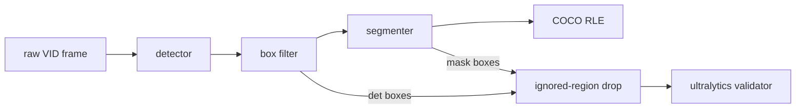
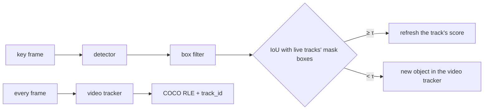

# Auto-labeling: zero-shot labels for VisDrone

How close a zero-shot auto-labeler (an open-vocabulary detector, a box filter, then a segmenter)
gets to VisDrone's ground truth, so a later effort can decide whether auto-labels seed or replace
human labels. Nothing is trained. Image mode labels single VisDrone-VID frames; its labeling
config is chosen by a staged grid of labeling trials, like [tuning](tuning.md), and the finalists
are read once on VID test-dev. VisDrone-DET isn't used: on the same frames it labels 1.6× VID's
objects, so a config tuned on it would fit the wrong labeling protocol.

## Scoring sets

| Set | Frames | Use |
|---|---|---|
| `train-sample` | 560: 10 evenly spaced from each of VID train's 56 sequences (48 recordings) | image-mode tuning; nothing is trained, so train is free to tune on |
| `val-stride20` | 146: every 20th VID val frame, the repo subset's val | the champion beside the image-mode finalists |
| `val-full` | 2,846: every frame of VID val's 7 sequences | sequence-mode tuning |
| `test-dev-full` | 6,635: every frame of VID test-dev's 17 sequences | the finalists, read once |

Each set's `ground_truth.json` carries VID's `track_id` per box.

## How a labeling trial works



- **Labeling config.** A stage YAML in `configs/autolabel/` lists trials, each a detector (a
  transformers repo and its prompts, each mapped to a merged class), the box filter, and a
  segmenter (a transformers SAM 2 repo, or none). `defaults` sections are updated key by key.
- **Box filter.** Its stages run in order, each optional: min side, max share of the frame,
  min score, class-agnostic NMS, the nested-box rule, top K. The nested-box rule keeps the
  *outer* box, so a box drawn around a group deletes the objects inside it.
- **Scores.** Two box sets per trial, `det` (the filtered detector boxes) and `seg` (each mask's
  tight box), both through `score_with_ap_small` at the 3 merged classes. **Selection is F1 at
  IoU 0.5**, from the validator's P and R; mAP and per-class numbers are recorded only.
- **Ignored regions.** VisDrone's rule, not the repo's: see
  [Scoring convention](#scoring-convention-ignored-regions).
- **Capped rows.** SAM 3 returns at most 200 boxes per prompt, so every row is also scored on the
  frames where no raw category has more than 200 GT boxes (`<kind>/uncapped200/*`);
  `gt/cap200/recall_ceiling` is the recall left. Both sets' densest frames hold under 200 boxes in
  total, so for now the subset is every frame.
- **Latency.** Per stage (detector, filter, segmenter) and in total, decoded image to RLE, batch 1,
  the first 3 images left out.
- **Records.** One MLflow run per trial in `aerial-auto-label`, with the config as params and the
  auto-labels as `autolabels-<split>.json`: COCO, masks as compressed RLE, `bbox` the mask's box,
  `det_bbox` the detector's, and the prompt under `attributes.label`.
- **Champion row.** The champion YOLO26 runs through the same scoring as a supervised reference
  (boxes only, unfiltered). It trained on VID train, so the runner skips it on `train-sample`.

## Sequence mode

A trial with a `tracker` section labels whole sequences (`val-full`, `test-dev-full`), so
objects keep one id across frames and the detector runs only on key frames.



- **Video trackers** (EdgeTAM, SAM 2.1 video, through transformers). Frame 0 and every K-th
  frame are key frames (`key_interval`). A kept box whose best IoU with the live tracks' mask
  boxes is below τ (`new_iou`, 0.3) starts a track. The tracker is never reset; its memory is
  pruned to each object's seed frame plus the last 16 frames, which keeps it flat. A track ends
  after 25 empty-mask frames (`empty_frames`) or 2 key frames without a match
  (`unmatched_keys`, the drift rule); of two tracks whose masks overlap at IoU > 0.8
  (`duplicate_iou`), the younger ends. A tracked frame carries the score of the last detection
  its track matched. `max_objects` caps live tracks; none by default.
- **Box-tracker controls** (`botsort`, `bytetrack`: ultralytics' default settings). The
  detector, box filter and segmenter run on every frame, once per stage: both controls reuse
  that pass. A detection is an auto-label when the tracker gives it a track.
- **Scores.** `det` scores the filtered detector boxes on key frames only, and `seg` every frame's
  auto-label boxes. Tracks go through TrackEval's MOTChallenge adapter
  (`trackeval==1.3.0`, a numpy-2 fork of upstream), once per merged class after the
  ignored-region rule, combined det-averaged: `track/HOTA` (DetA, AssA), `track/IDF1`,
  `track/MOTA`, `track/IDSW`, and per class. Stages that tune tracking settings select on HOTA,
  the rest on F1. The 3 merged classes aren't VisDrone-MOT's 5, so these numbers don't compare
  with published ones.
- **Records.** `latency/<stage>/amortised_ms`: each stage's (detector, filter, segmenter,
  tracker) total over the frames divided by the frame count, the first key-frame cycle left out
  as warm-up. `tracks/peak_live` is the most live tracks on any frame. The COCO file adds a
  `track_id` per auto-label; `det_bbox` appears only where a detection matched it.

## Scoring convention: ignored regions

**These numbers are not comparable with [tuning](tuning.md) or [evaluation](evaluation.md).** The
evaluator is the same (`score_with_ap_small`, ultralytics' validator), but the boxes fed to it
differ:

| | Repo (training, tuning, evaluation) | Auto-labeling |
|---|---|---|
| Ignored-region rows | deleted from the labels | kept, as each frame's ignored regions |
| Ground truth inside them | kept | dropped when ≥ half its area is inside their union |
| Predictions inside them | kept, so a hit on an unlabeled object is a false positive | dropped by the same rule |

Ignored regions are crowds and distant traffic the annotators left unlabeled. The champion learned
from those labels not to fire there, while a zero-shot detector never did, so the repo's
convention would charge it false positives for real objects and tune the box filter to copy the
annotators' gaps. VisDrone's own toolkit drops both sides, and the auto-labeler follows it.

The gap grows with the boxes a row keeps. The smoke trial keeps about 13 per frame: the rule drops
1.3% of `train-sample`'s ground truth (357 of 27,696) and 1.5% of its auto-labels, and moves its
F1 by 0.3 pt. The champion keeps boxes down to confidence 0.001: 12% of them fall in ignored
regions, and the rule lifts its `val-stride20` F1 from 67.6 to 69.6. The champion is re-scored here
under the same rule, so the rows in [Results](#results) compare with each other, never with its
numbers elsewhere.

## Commands

`.env` sets `DATA__RAW_DIR` (raw VisDrone-VID) and `DATA__AUTOLABEL_DIR` (the scoring sets).

```bash
# The scoring sets: frame links, YOLO labels, data.yaml, COCO ground truth + ignored regions.
uv run python -m mlops_cv.autolabel.visdrone_vid
# One stage on one set; --limit N labels and scores only the first N frames.
uv run python -m mlops_cv.autolabel configs/autolabel/smoke.yaml --set train-sample
uv run python -m mlops_cv.autolabel configs/autolabel/smoke.yaml --set val-stride20
# Sequence mode on whole sequences; --sequence NAME (repeatable) keeps only those.
uv run --env-file .env python -m mlops_cv.autolabel configs/autolabel/sequence-smoke.yaml \
  --set val-full --sequence uav0000305_00000_v
```

## Results

F1 at IoU 0.5 in %, under the [auto-labeling scoring convention](#scoring-convention-ignored-regions).

| Trial | Set | det F1 | seg F1 | Latency p50 (ms) |
|---|---|---|---|---|
| Smoke: GDINO-T → box filter → SAM 2.1 S | `train-sample` | 29.6 | 29.0 | 368 |
| Smoke: GDINO-T → box filter → SAM 2.1 S | `val-stride20` | 28.8 | 28.5 | 374 |
| Champion YOLO26m@1280 (reference) | `val-stride20` | 69.6 | — | 27 |

- **The smoke chain is recall-bound.** Precision is 80–84% and recall 17–18%. Grounding DINO-T
  returns 38 boxes per `train-sample` frame above its 0.25 floor, the box filter keeps 13
  (min side 8 px, ≤ 5% of the frame, score ≥ 0.4, NMS 0.6, nested-box IoS 0.8, top 300), and the
  ground truth holds 49. F1's own threshold sweep can't recover boxes the floors removed.
- **Masks keep their boxes.** Mask-derived boxes score within 0.6 pt F1 of the detector's.
- **Latency.** The detector is 239 ms and SAM 2.1 S 120 ms per frame (p50, RTX 5070 Laptop); the
  filter is under 1 ms. The auto-labels for 560 frames are 3.8 MB of COCO RLE.
