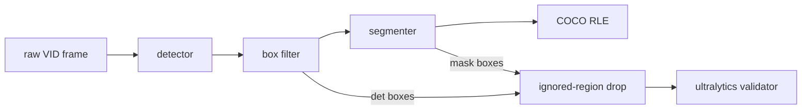

# Auto-labeling: zero-shot labels for VisDrone

How close a zero-shot auto-labeler (an open-vocabulary detector, a box filter, then a segmenter)
gets to VisDrone's ground truth, so a later effort can decide whether auto-labels seed or replace
human labels. Nothing is trained. Image mode labels single VisDrone-VID frames; its labeling
config is chosen by a staged grid of labeling trials, like [tuning](tuning.md), and the finalists
are read once on VID test-dev. VisDrone-DET isn't used: on the same frames it labels 1.6× VID's
objects, so a config tuned on it would fit the wrong labeling protocol.

## Scoring sets

| Set | Frames | Use |
|---|---|---|
| `train-sample` | 560: 10 evenly spaced from each of VID train's 56 sequences (48 recordings) | image-mode tuning; nothing is trained, so train is free to tune on |
| `val-stride20` | 146: every 20th VID val frame, the repo subset's val | the champion beside the image-mode finalists |

## How a labeling trial works



- **Labeling config.** A stage YAML in `configs/autolabel/` lists trials, each a detector (a
  transformers repo and its prompts, each mapped to a merged class), the box filter, and a
  segmenter (a transformers SAM 2 repo, or none). `defaults` sections are updated key by key.
- **Box filter.** The course's stages in order, each optional: min side, max share of the frame,
  min score, class-agnostic NMS, the nested-box rule, top K. The nested-box rule keeps the
  *outer* box, so a box drawn around a group deletes the objects inside it.
- **Scores.** Two box sets per trial, `det` (the filtered detector boxes) and `seg` (each mask's
  tight box), both through `score_with_ap_small` at the 3 merged classes. **Selection is F1 at
  IoU 0.5**, from the validator's P and R; mAP and per-class numbers are recorded only.
- **Ignored regions.** The VisDrone toolkit's rule drops any box with at least half its area in
  the union of the frame's ignored regions, from the auto-labels and the ground truth alike
  (`train-sample` loses 357 of 27,696 GT boxes, `val-stride20` 82 of 5,902).
- **Capped rows.** SAM 3 returns at most 200 boxes per prompt, so every row is also scored on the
  frames where no raw category has more than 200 GT boxes (`<kind>/uncapped200/*`);
  `gt/cap200/recall_ceiling` is the recall left. Both sets' densest frames hold under 200 boxes in
  total, so for now the subset is every frame.
- **Latency.** Per stage (detector, filter, segmenter) and in total, decoded image to RLE, batch 1,
  the first 3 images left out.
- **Records.** One MLflow run per trial in `aerial-auto-label`, with the config as params and the
  auto-labels as `autolabels-<split>.json`: COCO, masks as compressed RLE, `bbox` the mask's box,
  `det_bbox` the detector's, and the prompt under `attributes.label`.
- **Champion row.** The champion YOLO26 runs through the same scoring as a supervised reference
  (boxes only, unfiltered). It trained on VID train, so the runner skips it on `train-sample`.

## Commands

`.env` sets `DATA__RAW_DIR` (raw VisDrone-VID) and `DATA__AUTOLABEL_DIR` (the scoring sets).

```bash
# The scoring sets: frame links, YOLO labels, data.yaml, COCO ground truth + ignored regions.
uv run python -m mlops_cv.autolabel.visdrone_vid
# One stage on one set; --limit N labels and scores only the first N frames.
uv run python -m mlops_cv.autolabel configs/autolabel/smoke.yaml --set train-sample
uv run python -m mlops_cv.autolabel configs/autolabel/smoke.yaml --set val-stride20
```

## Results

F1 at IoU 0.5 in %.

| Trial | Set | det F1 | seg F1 | Latency p50 (ms) |
|---|---|---|---|---|
| Smoke: GDINO-T → course filter → SAM 2.1 S | `train-sample` | pending | pending | pending |
| Smoke: GDINO-T → course filter → SAM 2.1 S | `val-stride20` | pending | pending | pending |
| Champion YOLO26m@1280 (reference) | `val-stride20` | pending | — | pending |
