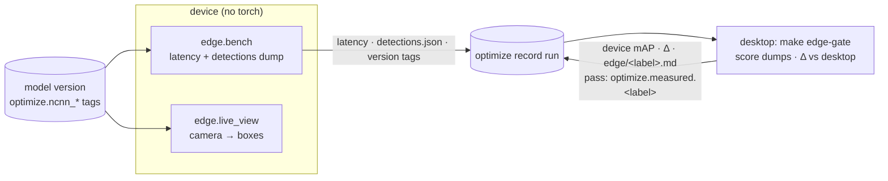

# Edge device: Raspberry Pi 5

Two tools run on the Pi, neither with torch or ultralytics:

| To | Run |
|---|---|
| measure a model on the Pi and gate it | `edge.bench` on the Pi, then `make edge-gate` on the desktop |
| watch the model on the camera | `edge.live_view` on the Pi, then open `http://<pi-host>:8090/` |

Both act on `aerial-object-detector-edge`, the edge target's registered model, and pull its NCNN
variants (published by [optimization](optimization.md)) from the desktop's MLflow.

`<pi>` below is the Pi's ssh target: `root@raspberrypi5.local` on the edge image (this repo's
Yocto build), your user and host on the stock Raspberry Pi OS.

## Set up the Pi

Once per card. Pick the OS:

- **Edge image** (this repo's Yocto build): the runtime and the camera stack are in the image.
  Build and flash it: [yocto/README.md](../yocto/README.md). The edge image is Python 3.14
  with the runtime packages above plus `rpicam-vid`; no pip, torch or git. Its rootfs is about 407 MiB (327 packages).

- **Raspberry Pi OS:** install the camera apps and a venv of the lock's `edge` group. On the desktop:

  ```bash
  uv export --no-default-groups --group edge --no-hashes --no-emit-project > requirements-edge.txt
  scp requirements-edge.txt <pi>:
  ```

  On the Pi:

  ```bash
  sudo apt install -y rpicam-apps      # ships on full Pi OS; rpicam-apps-lite on Lite
  python3 -m venv ~/.venvs/mlops-cv && source ~/.venvs/mlops-cv/bin/activate
  pip install --no-cache-dir -r ~/requirements-edge.txt
  ```

  The file pins the lock's OpenCV, which byte-exact preprocessing needs (`pip install ncnn` alone
  pulls any `opencv-python`). The venv is about 340 MB. Re-run both steps after a relock.

Then copy the code and the test-split frames from the desktop. Copy the code again after every
change; a reflash wipes both.

```bash
rsync -a --delete src <pi>:mlops-cv/
cd <subset-dir> && rsync -a --relative images/test <pi>:subset/   # the desktop's DATA__SUBSET_DIR
```

## Every session

On the desktop, `make mlflow-up`. On the Pi:

```bash
source ~/.venvs/mlops-cv/bin/activate                          # Raspberry Pi OS only
export PYTHONPATH=~/mlops-cv/src
export MLFLOW__TRACKING_URI=http://${SSH_CONNECTION%% *}:5000  # the desktop, over ssh
export DATA__SUBSET_DIR=~/subset
```

## Benchmark and gate a model

On the Pi:

```bash
python3 -m mlops_cv.edge.bench                                   # edge champion, every NCNN variant
python3 -m mlops_cv.edge.bench --model-version 2 --variants ncnn-fp16-1280
```

Then on the desktop:

```bash
make edge-gate                                   # champion
make edge-gate MODEL_VERSION=2
```

The bench times each variant and dumps its test-split detections onto the version's optimize
record run. The gate scores those dumps with ultralytics' validator and compares them with the
desktop's NCNN mAP50-95. It passes, and sets `optimize.measured.pi5` on the run, when every |Δ| is
within 0.5 pt (`OPTIMIZE__DEVICE_TOLERANCE_PT`); otherwise it exits 1. The run gets an
`edge/pi5.md` report.

**Another device:** run the bench with `--device-label <label>` and the gate with
`DEVICE_LABEL=<label>`. The bench decides the label (default `pi5`) and the gate can't relabel, so a
bench run without it overwrites the Pi 5's readings.

**Running again** replaces the readings: the bench clears the pass tag and overwrites the dumps,
and the gate rescores every published variant. After a reflash or a package change, re-bench every
variant (no `--variants`) before gating.

## Live view

```bash
python3 -m mlops_cv.edge.live_view                              # web: http://<pi-host>:8090/
python3 -m mlops_cv.edge.live_view --pull-only                  # pull the champion's ncnn-fp16-<imgsz>, print its dir
python3 -m mlops_cv.edge.live_view --model <dir>_ncnn_model     # a pulled model, no MLflow
DISPLAY=:0 python3 -m mlops_cv.edge.live_view --show screen     # Raspberry Pi OS desktop; q quits
```

It runs the camera through one variant, always on the newest frame, and shows frames/s, inference
ms, frame age and counts per class. Other flags: `--model-version`, `--variant`,
`--size 1280x720` (widths are multiples of 64), `--conf 0.3`, `--port 8090`. Stop it with Ctrl-C;
a background run takes `kill`, and then its `rpicam-vid` child needs one too.

## Troubleshooting

- **The Pi talks to `localhost:5000`:** use `MLFLOW__TRACKING_URI` (double underscore); a plain
  `MLFLOW_TRACKING_URI` is overwritten by the default.
- **403 "Invalid Host header":** the desktop's `MLFLOW_SERVER_ALLOWED_HOSTS` must allow LAN hosts
  (the default does).
- **The gate fails on the edge image:** its numpy and OpenCV come from Yocto, not the lock. The
  golden tests `tests/unit/test_serving_prepost.py` and `tests/unit/test_edge_runtime.py`, run on
  the Pi, show where the numerics drift.
- **After a reflash:** `ssh-keygen -R raspberrypi5.local` (new host keys), then copy the code and
  the frames again.

## How it works



`edge/runtime.py` runs an NCNN variant with `ncnn`, numpy, OpenCV and PyYAML: `serving.prepost`
for pre- and post-processing, plus a numpy port of ultralytics' NMS (NCNN export drops YOLO26's
NMS-free head). It matches `YOLO(dir).predict` exactly, pinned by a golden fixture. The tools also
need pydantic-settings for the `Settings` config, and the MLflow pull needs mlflow-skinny.

The bench logs latency under `optimize/<variant>/device/<label>/latency/*`, detections (at val's
settings, standing in for `model.val`) as `edge/<label>/<variant>/detections.json`, and the
device's ncnn/numpy/OpenCV versions as `optimize.<label>.*` tags. The gate adds
`optimize/<variant>/device/<label>/{precision,recall,mAP50,mAP50-95,delta_mAP50-95_pt}`. Δ is
against the desktop's NCNN reading, not the training run's `test/*`.

The device is never on the promotion path: the CT pipeline publishes the edge ladder and promotes
on the served tag alone. The bench and the gate run out of band, adding readings to the same
record run.
