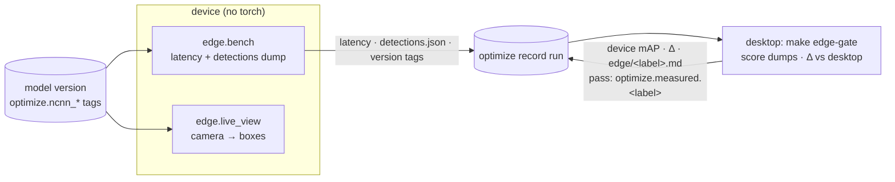

# Edge device: on-device benchmark and live view

`mlops_cv.edge` runs on the **Raspberry Pi 5**. It pulls the NCNN serving variants that
[optimization](optimization.md) published, times them on ARM and dumps their test-split
detections onto the same record run. The desktop scores those dumps with ultralytics and gates
them against its own readings. The device installs no torch and no ultralytics.



## Runtime

`edge/runtime.py` runs an NCNN variant with `ncnn` + numpy + OpenCV + PyYAML: `serving.prepost`
for pre- and post-processing, plus a numpy port of ultralytics' NMS (NCNN export drops YOLO26's NMS-free
head, so the graph's output still needs it). It matches `YOLO(dir).predict` exactly, pinned by
a golden fixture. Every edge tool (bench, live view) also needs pydantic-settings for the
**Settings**, and the MLflow pull needs mlflow-skinny.

Byte-exact preprocessing needs the lock's OpenCV.
`pip install ncnn` pulls an unpinned `opencv-python`, so the device installs the lock's pins (see
the setup).

## Benchmark harness

The desktop measures accuracy; the device re-measures it to confirm it holds on ARM, and is the
only source of its latency. On the device:

```bash
python -m mlops_cv.edge.bench                                    # edge champion, every NCNN variant
python -m mlops_cv.edge.bench --model-version 2 --variants ncnn-fp16-1280 --device-label pi5
```

Every edge tool acts on `aerial-object-detector-edge`, the edge deployment target's own registered
model. It logs latency under `optimize/<variant>/device/<label>/latency/*`, each variant's detections
on the test split as `edge/<label>/<variant>/detections.json` (at val's settings, so they stand in
for `model.val`), and the device's ncnn/numpy/OpenCV versions as `optimize.<label>.*` tags. Then
on the desktop:

```bash
make edge-gate                                   # champion, device label pi5
make edge-gate MODEL_VERSION=2 DEVICE_LABEL=pi5
```

It scores each dump with ultralytics' validator (`evaluation.score_detections`), logs
`optimize/<variant>/device/<label>/{precision,recall,mAP50,mAP50-95,delta_mAP50-95_pt}` and an
`edge/<label>.md` report, and sets `optimize.measured.<label>` when every |Δ| is within 0.5
percentage points of mAP50-95 (`OPTIMIZE__DEVICE_TOLERANCE_PT`); otherwise it exits 1. Δ is against the desktop
**NCNN** reading, not the training run's `test/*`.

The device is never on the promotion path: the CT pipeline publishes the edge ladder and promotes
on the served tag alone. Bench and gate run out-of-band, adding readings to the same record run.

## Raspberry Pi 5 setup

On Raspberry Pi OS, the Pi installs the `edge` dependency group, exported from the lock, into a
plain-pip venv (the lock is platform-specific, and Raspberry Pi OS ships a newer Python than the
project's pin). The [edge image](#edge-image-yocto) skips the venv and the clone.

From the desktop, once — a key, an ssh alias, and agent forwarding so the Pi can clone from
GitHub with the desktop's key:

```bash
ssh-keygen -t ed25519 -N "" -f ~/.ssh/id_ed25519_pi
cat >> ~/.ssh/config <<'CFG'
Host pi
    HostName <pi-host>
    User <pi-user>
    IdentityFile ~/.ssh/id_ed25519_pi
    ForwardAgent yes
CFG
ssh-copy-id -i ~/.ssh/id_ed25519_pi.pub pi      # the one password prompt
uv export --no-default-groups --group edge --no-hashes --no-emit-project > requirements-edge.txt
scp requirements-edge.txt pi:
```

On the Pi:

```bash
ssh -T git@github.com && git clone git@github.com:<owner>/mlops-cv.git
sudo apt install -y rpicam-apps      # the camera; ships on full Pi OS, rpicam-apps-lite on Lite
python3 -m venv ~/.venvs/mlops-cv && source ~/.venvs/mlops-cv/bin/activate
pip install --no-cache-dir -r ~/requirements-edge.txt
pip install --no-cache-dir --no-deps --ignore-requires-python -e ~/mlops-cv
python -c "import ncnn, cv2; print(cv2.__version__)"   # the lock's version
```

`--ignore-requires-python` steps over the project's Python pin; the device imports only plain-Python
modules. The venv is about 340 MB (the torch install it replaced was 1.4 GB). Re-run the export
and the install after a relock.

Copy the test-split frames once:

```bash
cd <subset-dir>       # the desktop's DATA__SUBSET_DIR
rsync -a --relative images/test pi:<pi-subset-dir>/
```

Every session, point the Pi at the desktop's MLflow and at the copy:

```bash
export MLFLOW__TRACKING_URI=http://${SSH_CONNECTION%% *}:5000   # over ssh; else the desktop's IP
export DATA__SUBSET_DIR=<pi-subset-dir>
```

Use the double-underscore **Settings** key: a plain `MLFLOW_TRACKING_URI` is overwritten by the
`localhost:5000` default. The desktop side already publishes port 5000 on all interfaces and
allows LAN hosts in `MLFLOW_SERVER_ALLOWED_HOSTS` (without that, 403 "Invalid Host header").

## Live view

`python -m mlops_cv.edge.live_view` runs the camera through one NCNN variant and draws the
boxes, always on the newest frame, with stats (frames/s, inference ms, frame age, counts per
class).
Frames come from an `rpicam-vid` child piping raw I420, so `--size` widths are multiples of 64.

```bash
python -m mlops_cv.edge.live_view                       # web: http://<pi-host>:8090/
DISPLAY=:0 python -m mlops_cv.edge.live_view --show screen   # a window on the Pi's display, q quits
python -m mlops_cv.edge.live_view --pull-only           # pull the champion's ncnn-fp16-<imgsz>, print its dir
python -m mlops_cv.edge.live_view --model models/ncnn-fp16-1280_ncnn_model  # no network
```

Without `--model` it pulls from MLflow, so it needs the `MLFLOW__TRACKING_URI` export above.
Other flags: `--model-version`, `--variant`, `--size 1280x720`, `--conf 0.3`, `--port 8090`.
`DISPLAY=:0` targets the desktop session logged in on the Pi.

## Edge image (Yocto)

The **edge image** is a headless Yocto image for the Pi 5 that carries the runtime
instead of a venv: Python 3.14 with `ncnn`, numpy, OpenCV, PyYAML, pydantic-settings and
mlflow-skinny, plus the camera stack (`rpicam-vid`). It has no pip, torch or git. The rootfs is
416,292 KiB (about 407 MiB, 327 packages). Building and flashing: [yocto/README.md](../yocto/README.md).

The device workflow replaces the venv steps above: rsync the code, run it with
`PYTHONPATH`. The test-split copy and the session exports are as in the setup.

```bash
rsync -a --delete src root@raspberrypi5.local:/root/mlops-cv/   # desktop, after every change
export PYTHONPATH=/root/mlops-cv/src                              # on the Pi
python3 -m mlops_cv.edge.bench --device-label pi5
```

**Before it serves:** the image's numpy and OpenCV come from Yocto's recipes, not the lock, so
`make edge-gate` is the bar. If the gate fails, the prepost and NCNN decode golden tests
(`tests/unit/test_serving_prepost.py`, `tests/unit/test_edge_runtime.py`, run on the Pi) show
where the numerics drift. The image is built; these on-device checks haven't run yet.
