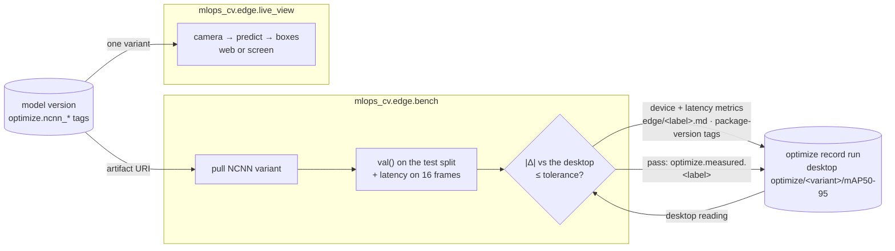

# Edge device: on-device benchmark and live view

`mlops_cv.edge` runs on the **Raspberry Pi 5**. It pulls the NCNN serving variants that
[optimization](optimization.md) published, re-measures them on ARM against the desktop's
readings, and logs the results onto the same record run. A live view runs one variant on the
camera.



## Benchmark harness

The desktop measures every variant's accuracy, and the device re-measures its NCNN variants' to
confirm the number holds on ARM. Latency can only come from the device. The on-device harness
pulls each published NCNN artifact by the model version's tags and logs onto the **same record
run**, found by following the artifact URI, so the device's readings land beside the desktop's:

```bash
python -m mlops_cv.edge.bench                                    # champion, every NCNN variant
python -m mlops_cv.edge.bench --model-version 2 --variants ncnn-fp16-320 --device-label pi5
```

It reads the test split from the device's `DATA__SUBSET_DIR` (copied once, see the setup below)
and writes its own `<template>-test.yaml` there, with `path:` stamped absolute and every split
pointing at `images/test` (ultralytics' dataset check needs a `val:` entry). For each variant it
logs:

| Reading | Keys |
|---|---|
| Accuracy: `val()` on the test split, batch 1, CPU, at the variant's resolution | `optimize/<variant>/device/<label>/{precision,recall,mAP50,mAP50-95}` |
| Δ against the desktop's `optimize/<variant>/mAP50-95`, in points | `optimize/<variant>/device/<label>/delta_mAP50-95_pt` |
| Latency on the first 16 test frames, the same ones the desktop times | `optimize/<variant>/device/<label>/latency/{p50,p95,p99,mean}_ms`, `…/n` |

plus the device's `optimize.<label>.{ultralytics,ncnn,torch}` versions as run tags, so a failed
gate can be told apart: version drift or ARM numerics.

It also logs **`edge/<label>.md`** (e.g. `edge/pi5.md`) on the record run: the model and device
label, one row per variant with the desktop and device mAP50-95, Δ in points, device P50/P95
latency and pass/fail against the tolerance, then the package versions. It is written even when
the gate fails, so a failing run still records the numbers and versions behind it. The desktop's
`optimization.md` is left untouched.

Readings logged before latency moved under `device/<label>/` (champion v1's earlier Pi latency)
sit under the old `optimize/<variant>/latency/<label>/` keys; re-run the bench to refresh them.

**The gate.** If any |Δ| exceeds `OPTIMIZE__DEVICE_TOLERANCE_PT` (default 0.5 pt), the harness
logs everything, names the variant and both readings, leaves `optimize.measured.<label>` unset
and exits 1. Otherwise it sets that tag. Champion v1's measured gap is 0.05 pt, and a full
640 val takes about 70 s on a Pi 5. Δ is taken against the desktop **NCNN** reading, never
the training run's `test/*`: NCNN export disables YOLO26's end2end head, which alone moves
champion v1 by 0.6 pt. If the record run lacks the desktop reading, the harness refuses to
start and asks for a `make optimize` re-run.

## Raspberry Pi 5 setup

The uv lock is platform-specific (CUDA-13 torch pins) and Raspberry Pi OS ships a newer Python
than the project's pin, so the Pi runs a plain-pip venv. Two traps shape the install order:
PyPI's aarch64 torch wheel is the **ARM server build** and drags ~1.5 GB of CUDA libraries onto
a device with no GPU, so torch comes from the CPU index *before* ultralytics; and the camera
library only exists as an apt package, so the venv must see system site-packages.

From the desktop, once — a key, an ssh alias, and agent forwarding so the Pi can clone from
GitHub with the desktop's key:

```bash
ssh-keygen -t ed25519 -N "" -f ~/.ssh/id_ed25519_pi
cat >> ~/.ssh/config <<'CFG'
Host pi
    HostName <pi-host>
    User <pi-user>
    IdentityFile ~/.ssh/id_ed25519_pi
    ForwardAgent yes
CFG
ssh-copy-id -i ~/.ssh/id_ed25519_pi.pub pi      # the one password prompt
```

The Pi's versions come from the lock: on-device accuracy matches the desktop's only when
ultralytics and ncnn match. On the desktop, export the six packages the Pi needs, dropping the
lock's CUDA local tag (`+cu130`), and copy the file over (it is not committed):

```bash
uv export --no-hashes --all-groups --no-emit-project \
  | grep -E '^(ultralytics|ncnn|mlflow-skinny|pydantic-settings|torch|torchvision)==' \
  | grep -v "sys_platform != 'linux'" \
  | sed -E 's/\+cu[0-9]+//; s/ ;.*//' > requirements-edge.txt
scp requirements-edge.txt pi:
ssh pi
```

On the Pi:

```bash
ssh -T git@github.com && git clone git@github.com:<owner>/mlops-cv.git
sudo apt install -y python3-picamera2
python3 -m venv --system-site-packages ~/.venvs/mlops-cv && source ~/.venvs/mlops-cv/bin/activate
pip install --no-cache-dir --index-url https://download.pytorch.org/whl/cpu \
    $(grep -E '^torch(vision)?==' ~/requirements-edge.txt)
pip install --no-cache-dir -r ~/requirements-edge.txt
pip install --no-cache-dir --no-deps --ignore-requires-python -e ~/mlops-cv
python -c "import torch, ncnn, picamera2; print(torch.__version__, torch.cuda.is_available())"
```

The last line should print a `+cpu` torch at the lock's version and `False`. The second install
keeps the CPU torch, since `torch==X` is satisfied by `X+cpu`. `--ignore-requires-python` steps
over the project's Python pin: the Pi imports only the pure config/tracking modules. Re-run the
export and both installs after a relock.

The harness measures accuracy on the test split, so copy it from the desktop's
`DATA__SUBSET_DIR` into the Pi's (about 115 MB, about 12 s on the LAN):

```bash
cd <subset-dir>       # the desktop's DATA__SUBSET_DIR
rsync -a --relative images/test labels/test manifest.csv *.yaml pi:<pi-subset-dir>/
```

Every session, point the tracking client at the desktop and the harness at the copy:

```bash
export MLFLOW__TRACKING_URI=http://${SSH_CONNECTION%% *}:5000
export DATA__SUBSET_DIR=<pi-subset-dir>
```

`SSH_CONNECTION` starts with the address you connected from, so the URI follows the desktop
across DHCP renewals. The key is the **Settings** one with a double underscore: the client
exports `settings.mlflow.tracking_uri` over any `MLFLOW_TRACKING_URI` already in the
environment, so the single-underscore form is silently replaced by the `localhost:5000`
default — the Pi's own, empty, localhost. Two LAN prerequisites are handled on the desktop side:
port 5000 is published on all interfaces, and the MLflow server's Host-header allowlist includes
the private ranges — `MLFLOW_SERVER_ALLOWED_HOSTS` *replaces* MLflow's default allowlist to add
`192.168.*,10.*`; without that, LAN calls fail with 403 "Invalid Host header".

## Live view

`python -m mlops_cv.edge.live_view` runs the camera through one NCNN variant and draws the boxes.
A capture thread keeps only the newest frame, so the view runs at inference speed and never
queues. Each frame goes through `predict` at the variant's resolution, then `result.plot()`, then
the stats: model, frames/s, inference ms, frame age (capture to drawn) and counts per class.

```bash
python -m mlops_cv.edge.live_view                       # web: http://<pi-host>:8090/
DISPLAY=:0 python -m mlops_cv.edge.live_view --show screen   # a window on the Pi's display, q quits
python -m mlops_cv.edge.live_view --pull-only           # pull the champion's ncnn-fp16-640, print its dir
python -m mlops_cv.edge.live_view --model models/ncnn-fp16-640_ncnn_model   # no network
```

- **`--show web`** (the default) serves a page with the stream and a stats panel at `/`, the
  MJPEG stream at `/stream.mjpg` and the stats JSON at `/stats`, on `--port` (default 8090,
  since 8000 is serving's).
- **`--show screen`** opens an OpenCV window with the stats overlaid. From an ssh session,
  `DISPLAY=:0` targets the desktop session logged in on the Pi.
- **The model** is `--model <dir>`, or `--model-version` (default: the champion) plus
  `--variant` (default `ncnn-fp16-640`), pulled into `./models`. Other flags: `--size 1280x720`
  (capture size), `--conf 0.3` and `--label` (the model name shown).
