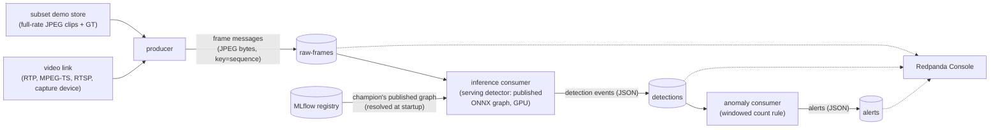

# Streaming inference (Redpanda + Kafka)

Real-time video inference over Kafka-compatible broker: a **producer** replays the
subset's demo store as a live-like camera feed, or decodes a drone's live **video link**
(below), a **GPU inference consumer** runs the
champion's published ONNX graph and publishes one detection event per frame, and an
**anomaly consumer** watches those events through a windowed count rule and raises
alerts. Everything is observable end-to-end in Redpanda Console.

The inference consumer answers with **the same inference path as the HTTP detection
service**: the serving detector over the champion's published ONNX graph (onnxruntime
CUDA), with class names read from the graph's own embedded metadata and the same default
confidence floor. One model artifact, one pre/post implementation .



## Quick start

### Option A: consumers as host CLI

To run a consumer on the host, put the venv's CUDA libraries on the
loader path the way `make serve` does (onnxruntime resolves CUDA through the system loader)

```bash
# MLflow stack + Redpanda + Console + topic init
# Console UI at http://localhost:8085
make streaming-up
# teardown: make streaming-down; logs: make streaming-logs

# Terminal 1 — the anomaly watcher (tail mode):
uv run python -m mlops_cv.streaming.anomaly_consumer

# Terminal 2 — GPU inference on the champion (start consumers BEFORE producing):
LD_LIBRARY_PATH="$(echo .venv/lib/python*/site-packages/nvidia/*/lib | tr ' ' ':')" \
  uv run python -m mlops_cv.streaming.inference_consumer

# Terminal 3 — replay the demo clips as a 30 fps camera:
uv run python -m mlops_cv.streaming.producer --loops 1
```

### Option B: consumers from serving stack

Both consumers run as containers (they ship in one streaming image — the serving detector
plus the Kafka loop; no torch, no ultralytics). The producer stays a host CLI: it reads
the demo store from host disk.

```bash
# Broker + Console + topics + both consumers + the detection service:
make serving-up
# teardown: make serving-down / streaming-down; logs: make serving-logs

uv run python -m mlops_cv.streaming.producer --loops 1
```

The producer needs the subset's demo store (`make ingest` builds it); it fails with that
hint if the store is absent. The inference consumer needs the MLflow stack (it resolves
the champion's published graph at startup) and the GPU; a registry with no champion, or a
champion whose version carries no published-graph tag — the consumer exits.

### Watching the stream

`make stream-view` (it brings up `serving-up` first; start it before the producer), then open
`http://localhost:8091`. It pairs `raw-frames` with `detections` by frame address and the
browser draws the detections over each frame (a metadata overlay; the server never decodes a
JPEG).

- **Controls**, all in the browser: boxes on/off, a confidence slider from the confidence
  floor up, one checkbox per merged class.
- **Panel**: sequence, model version, frames/s, frame age (a stall shows as a growing red
  age), inference latency, the sequence's dropped frames and the sequence switches seen.
- **Sequence**: it follows the newest one, so a new link session takes over; `--sequence`
  pins one.
- **Read-only**: group `stream-view`, latest offsets, commits nothing, produces nothing. A slow
  browser skips to the newest frame instead of queueing.

## Topics & message contracts

Topics are provisioned by a one-shot `rpk` init service — broker auto-creation stays off.

| Topic | Partitions | Value | Key | Notes |
|---|---|---|---|---|
| `raw-frames` | 3 | JPEG bytes verbatim (re-encoded under `--shift` or from a link) | sequence | `max.message.bytes` raised to 4 MiB; retention 1 h or 16 GiB per partition, whichever is hit first (`FRAME_RETENTION_MS` / `FRAME_RETENTION_BYTES` in `docker-compose/.env.streaming`, applied on the next `make streaming-up`); metadata in headers (`frame_index`, `ts_ms`) |
| `detections` | 3 | detection event JSON | sequence | co-partitioned with frames |
| `alerts` | 1 | alert JSON | sequence | episode-scoped |

All payloads are owned by one module (`mlops_cv.streaming.messages`) with the emit↔parse
pairs pinned by unit tests. Detection events carry
`schema_version`, the frame address (`sequence`, `frame_index`), timestamps, latency,
**which model answered** (`model.name`/`model.version`), and per-box class names +
confidences + normalized `xywhn` (resolution-independent across the mixed-size clips).
Parsers ignore unknown fields, so adding a field is not a breaking change — renaming or
removing one is.

Both topics have a third reader: the **drift monitor** tails them under its own group,
judging the frames against the champion's training baseline and charting the detection
events beside it ([monitoring.md](monitoring.md)). It commits nothing and produces nothing.
Its drift windows pool every sequence (fleet-wide), so one drifting link among several is diluted.

**Frames delivered inline** — a deliberate choice, valid because the demo-store JPEGs
sit under the ~1 MiB sweet spot (~450 KB average). Production systems outgrow this in two
directions, both documented below under *Scaling up*.

## Delivery semantics

The inference consumer is **at-least-once, effectively-once end-to-end**:

- The producer and both event publishers run with `enable.idempotence=true` (broker
  dedups client retries; `acks=all` implied).
- Offsets are **stored only in the delivery callback** of the corresponding detection
  event — i.e. after the broker confirmed the produce — and committed on a timer
  (`enable.auto.commit=true` + `enable.auto.offset.store=false`: the timer commits what
  the loop stored, never the poll position). A crash or rebalance replays the
  uncommitted tail.
- Replayed frames yield **duplicate detection events**, idempotently addressed by
  `(sequence, frame_index)` — windowed readers barely notice; strict readers dedup,
  keeping the later `ts_infer_ms`. After a champion swap a replayed frame can carry a
  *different* answer under a *different* model version — which is exactly why events
  self-identify their model.
- Offset stores are **monotonic per partition**: skipped frames store synchronously
  while earlier frames' delivery callbacks are still in flight, and without the
  max-guard a late callback would move the bookmark backwards.
- Undecodable frames are logged, counted, and skipped *with* their offset stored — a
  poison message must not wedge the partition.
- A detection-event delivery failure stops the loop (fail fast): with an idempotent
  producer it is never a blip, and continuing could commit past the failed frame.

Exactly-once (EOS transactions) is the documented step-up, not built: it adds a
transactional producer with epoch fencing, `read_committed` on every downstream
consumer, and a new failure taxonomy — to eliminate a duplicate that costs this pipeline
nothing. The at-least-once + idempotent-output pattern is what streaming inference
pipelines overwhelmingly ship.

`--offset-reset` applies **per partition**, and only where the group has no committed
offset. Two practical consequences:

- A restarted consumer *resumes from committed offsets* — the flag is ignored for
  partitions it has already acknowledged. Replay deliberately with a fresh group or an
  explicit `--offset-reset earliest`.
- In `latest` mode, **start consumers before producers**: messages published to a
  partition before the group first reads it fall before the `latest` watermark and are
  silently skipped.

## Pacing & back-pressure

The producer paces at the clip frame rate by default. `--fps 0`
floods the topic as fast as disk allows; consumer-group lag then climbs (a full clip
backlogs within seconds) and drains at GPU speed — watch it in Console or via
`docker exec redpanda rpk group describe inference-consumer`. The consumer additionally
pauses frame intake whenever too many detection events await broker confirmation and
resumes once the queue drains, keeping its memory bounded under flood.

## Simulating drift

The producer can dial a **synthetic photometric shift** into the stream, so the drift
monitor can be watched crossing its bars, opening an episode, and re-arming on demand
(what it measures and how it judges: [monitoring.md](monitoring.md)):

```bash
uv run python -m mlops_cv.streaming.producer --shift defocus --loops 2 --fps 0
uv run python -m mlops_cv.streaming.producer --shift brightness --loops 2 --fps 0
```

| Mode | Dial | What it demonstrates |
|---|---|---|
| `defocus` | Gaussian blur radius (default 4) | a **malignant** shift — it destroys most of the champion's detections, and the charted detection rate collapses with it |
| `brightness` | multiplier (default 0.35) | a **benign** shift — the model absorbs it (ultralytics trains HSV augmentation by default), so only the input-side alarm moves |

## Video links

`--link` decodes a live drone or UGV video link (PyAV, host only) into the same Frame
messages, so nothing downstream changes. It sets its own pace, so it refuses the demo-store
flags; `--shift` still applies. Run one producer per link, each with its own `--link-name`.

| The receiver sends to the producer host as | `--link` |
|---|---|
| bare RTP (OpenHD, wfb-ng, OpenIPC, QGC) | a shipped SDP: `configs/link/rtp-h264-5600.sdp` or `rtp-h265-5600.sdp` (another port or payload type: copy it and edit the `m=` line) |
| MPEG-TS over UDP | `udp://0.0.0.0:<port>` |
| RTSP | its `rtsp://` URL |
| DJI RTMP | a MediaMTX relay, then its `rtsp://` URL |
| capture device (HDMI dongle on goggles, webcam) | Linux: `/dev/video0 --link-format v4l2`; macOS: `0 --link-format avfoundation`; FFmpeg input options via `--link-option key=value`. The goggles' OSD is burned in. |

- **Frame addresses.** A link session's sequence is `<link-name>-<UTC start>`, e.g.
  `uav1-20261018T120000Z`; `frame_index` counts dropped frames too, so a gap shows a drop.
- **Drop rule.** Damaged frames are dropped until the next keyframe (`dropped N damaged`).
- **Dead links.** "link lost" logs after about 5 s on UDP/TS and 10 s on RTP; the producer
  reopens every second and the next frame starts a new link session.
- **Firewall.** When the ground station is a separate machine, the producer host's firewall
  must allow inbound UDP on the link port; a receiver on the producer host itself needs none.
- **Bus cost.** About 115 Mbit/s per 1080p30 video link at JPEG q95. `raw-frames` holds at
  most 16 GiB per partition or 1 h (`docker-compose/.env.streaming`), whichever comes first:
  about 20 min of one link.
- **Throughput.** One inference replica serves its drain rate ÷ the link frame rate in links.
  The drain rate depends on the host's CPU (JPEG decode dominates), GPU and model, so measure it
  on the target: stop the consumer, let a backlog build, then time the committed offset's climb.
  Scale with `make serving-up INFERENCE_REPLICAS=N`, up to the `raw-frames` partition count
  (extra replicas idle). Size for the busiest partition, not the average: links hash to
  partitions by sequence regardless of load, so several can share one partition and its one
  replica. Rising lag on the dashboard is the signal. `SERVING__MAX_INFLIGHT` (default 2) sets
  how many frames a consumer has in flight, overlapping one frame's decode with another's GPU
  run (events still leave in poll order); each slot costs VRAM. Measured reference (RTX 5070
  Laptop, 24 cores): ~128 frames/s per replica (~99 with one in flight), so ~3 1080p30 links.
- **Crowd rule.** Link frames may detect fewer objects than the demo store, so the default
  `STREAMING__ANOMALY_THRESHOLD`, set on demo replay, may not fire on a link. Adjust it per site.

```bash
make link-sim       # the fake drone: a demo clip looped as H.264 RTP on :5600
make link-produce   # its producer: --link data/link-sim/link-5600.sdp --link-name uav1
# a second link: make link-sim LINK_PORT=5602 / make link-produce LINK_PORT=5602 LINK_NAME=uav2
```

`LINK_SEQ` picks the clip and must be an existing directory of `%07d.jpg` frames, such as a
demo-store clip (default: `<DATA__SUBSET_DIR>/demo/images/uav0000073_00600_v`, built by
`make ingest`), e.g. `make link-sim LINK_SEQ=/abs/path/to/clip`.

### Example: streaming from an edge device's camera (Raspberry Pi 5)

```bash
# On the Pi (set --intra: its default of 60 is a 2 s GOP, so each loss drops up to 2 s):
rpicam-vid -t 0 -n --width 1920 --height 1080 --framerate 30 --bitrate 8000000 --intra 5 \
  --low-latency --inline --codec libav --libav-format mpegts -o "udp://<host>:5600?pkt_size=1316"
# On the producer host (<host> above):
uv run python -m mlops_cv.streaming.producer --link udp://0.0.0.0:5600 --link-name pi5cam
```

| OS | Get `rpicam-vid` |
|---|---|
| Raspberry Pi OS | `apt install rpicam-apps` |
| Buildroot | Raspberry Pi's libcamera fork (`raspberrypi/libcamera`, `rpi/pisp` pipeline) plus libpisp; `rpicam-apps` with `ffmpeg` (GPL), `x264` and `libdrm`. `camera_auto_detect=1`, or `dtoverlay=<sensor>,cam0` for a board it misses. No udev: `modprobe -a i2c-designware-platform rp1-cfe pisp_be <sensor>` |
| Yocto (meta-raspberrypid) | `RASPBERRYPI_CAMERA_V2`/`_V3 = "1"`, or `RPI_EXTRA_CONFIG = "dtoverlay=<sensor>,cam0"` for a board the default misses; `PACKAGECONFIG:append:pn-libcamera-apps = " libav"`. The layer builds upstream libcamera, so point its `SRC_URI` at Raspberry Pi's fork as on Buildroot. |

Measured on a Pi 5 (IMX219, 1080p30, 4 Mbit/s) under bursty ~2% packet loss (netem `gemodel`):
1.4% of frames dropped as damaged at `--intra 5`, 8.9% at `--intra 30`.

## The anomaly rule

Episode-scoped windowed count: alert when the sliding-window mean count of a configured
class crosses a threshold; fire **once** when the condition begins, re-arm only after it
clears. The window runs over **frame time** (the
producer's publish timestamps), so flood-mode replay doesn't distort episodes, and
entries are keyed by frame address so at-least-once duplicates never double-count.
The mean and the episode are per sequence, so each video link or demo clip alerts on its own.
Rule parameters live in settings (`STREAMING__ANOMALY_CLASS`, `…_WINDOW_S`,
`…_THRESHOLD`).

## Champion rollout

The inference consumer resolves the champion's published graph **once at startup**.
A promotion therefore changes what a *restarted*
consumer serves, and the changeover is visible in the stream as the events'
`model.version` flips. Hot-reload (poll the registry, swap weights without dropping the
consumer group) is a step-up for long-lived services.

## Scaling up

- **Claim check** — once frames exceed the ~1 MiB sweet spot (bigger cameras, higher
  quality), the bytes move to object storage and the frame message becomes a reference +
  metadata. Raising `max.message.bytes` further is the wrong lever.
- **Schema registry** — the JSON contracts move to registry-managed Avro/Protobuf
  (Redpanda ships a schema-registry API) for enforced compatibility across teams.
- **Video-native ingestion** — at real camera-fleet scale, pixels stop transiting Kafka
  entirely (RTSP/GStreamer straight into the GPU pipeline) and Kafka carries only
  detection metadata; the detections/alerts topology here survives that swap unchanged.
  A link decoded straight into the GPU process (DeepStream or a direct decoder) saves the
  JPEG round trip and the Kafka hop (about 20 ms per 1080p frame) and the bus bytes. It
  costs the drift monitor its pixels, replay after a crash, and fan-out to several readers,
  so it is the fleet-scale step, not the one-link default.
- **Batched inference** — ruled "later": no backlog at the paced rate, decode costs more than
  the GPU pass, and a batch axis changes the published graph. Triggers in
  [optimization.md](optimization.md#production-step-ups).
- **Exactly-once** — only if downstream consumers appear for which a duplicate event has
  real cost.
- **Operator-grade overlay** — the professional pattern is a metadata overlay in the
  operator's own player. Defense GCS/ATAK use STANAG 4609 / MISB: KLV in the MPEG-TS, with
  targets as MISB ST 0903 VMTI, keyed to the video's PTS; the web uses WebRTC video plus JSON
  boxes synced on PTS. Both need detection events to carry the source PTS, the `pts` header
  the link source left out. The stream view pairs by frame address instead.

## Cloud migration

The environment switch is configuration, not code: the broker
address is `STREAMING__BOOTSTRAP_SERVERS` (with credentials injected as env vars / a secret
manager in cloud). Two paths, distinguished by how much the transport client changes.

**Managed Kafka (client unchanged).** A managed Kafka-API broker is wire-compatible, so
`confluent-kafka` talks to it untouched: point `STREAMING__BOOTSTRAP_SERVERS` at the managed
cluster (plus SASL/TLS credentials) and the producer and both consumers run exactly as they do
locally. Examples: Amazon MSK, Azure Event Hubs' Kafka endpoint,
Google Managed Service for Apache Kafka, or Confluent Cloud (on any of the three).

**Native cloud streaming (transport plumbing swapped).** A provider's own streaming service —
e.g. Amazon Kinesis, Google Pub/Sub, Azure Event Hubs (native API) — is *not* Kafka-wire, so the
thin publish/consume layer is rewritten for that client. Everything that matters ports untouched:
the message contracts (`streaming/messages.py`) are plain pydantic, transport-agnostic; the
pipeline logic (the producer's replay loop, the injectable inference callable, the pure
`EpisodeRule`) never mentions Kafka. Only the transport calls change, and the concepts map 1:1:

| Kafka concept | Native-streaming equivalent |
|---|---|
| topic | topic / stream |
| partitions, keyed by `sequence` | shards / ordering keys (by partition key) |
| consumer group | subscription (or the service's consumer-group equivalent) |
| committed offsets (`__consumer_offsets`) | per-subscriber ack state / checkpoints |
| `max.message.bytes` 4 MiB | provider message cap (~1–10 MiB) |

At-least-once carries over directly — these services are at-least-once by default (`ack()` /
checkpoint after the detection event is published), and the same `(sequence, frame_index)`
idempotent addressing absorbs the duplicates.

**The GPU inference consumer becomes a managed GPU service** — a serverless GPU runtime (e.g.
Cloud Run GPU) or a GPU pod on managed Kubernetes (EKS / AKS / GKE).

**Frames at fleet scale** move to the claim-check pattern (bytes in object storage — S3 / GCS /
Azure Blob — with a reference on the topic) or rely entirely for video-native ingestion
— see *Scaling up* above.
