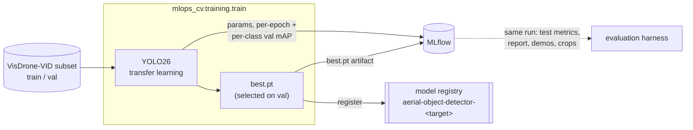

# Training (YOLO26 transfer learning)

Train **YOLO26** on the merged 3-class VisDrone-VID subset and log the experiment to MLflow: the
recipe, per-epoch metrics, `best.pt`, dataset lineage, and a registered model version. One run is
one reproducible, comparable experiment. Training is **pure model production** — the held-out test
metrics, comparison report, and qualitative artifacts (demo videos, error-analysis crops) come from
the [evaluation harness](evaluation.md), which can log them **onto the same run** (`--run-id`).



## Run it

```bash
make mlflow-up
uv run python -m mlops_cv.training --epochs 10
# or with `make train` (brings the MLflow stack up idempotently)

# then evaluate the new version onto the same run (test metrics + report + visuals):
uv run python -m mlops_cv.evaluation --model runs:/<run_id>/weights/best.pt --run-id=<run_id>
# or with `make eval MODEL=runs:/<run_id>/weights/best.pt RUN_ID=<run_id>`

```

A run trains for one **deployment target** (`--target server|edge`, default `server`), which
picks the registered model (`aerial-object-detector-server` / `-edge`) and the production default
size: server `yolo26m`, edge `yolo26n`, both at imgsz 1280 with the shared recipe
([tuning.md](tuning.md#final-recipe)). The model is evaluated, exported and served at the imgsz it
trained at, read back from the run's `imgsz` param. CLI flags
`--model --epochs --imgsz --batch --seed --device --no-amp` override those defaults. `--set key=value` (repeatable, YAML-parsed) passes any other `model.train()` argument,
and `--no-register` makes the run a [trial](tuning.md). The dataset is always `DATA__SUBSET_DIR`,
so the manifest and data-version lineage match the weights. The run logs to the server named by
`MLFLOW__TRACKING_URI` (the local stack by default). ultralytics keeps its settings in the repo's
`.ultralytics/` (`YOLO_CONFIG_DIR`, set when `mlops_cv` is imported).
With [direnv](https://direnv.net), the repo's `.envrc` sets it for shell tools too (the `yolo`
CLI, notebooks); run `direnv allow` once.

The process's **last stdout line** is a machine-readable handoff for orchestrators:
`{"version": "<registered version>", "run_id": "<mlflow run id>"}` — a continuous-training DAG (or
a shell script) reads it to evaluate and promote the exact version this run produced. The payload
schema (`TrainHandoff`) and the container command line are owned by the shared contract module
`mlops_cv.orchestration.handoff`, which both the emitter and the orchestrator import.

## What gets logged

| Logged | Source |
|---|---|
| hyperparameters | the built-in ultralytics MLflow callback |
| per-epoch losses + val `mAP50` / `mAP50-95` / P / R | built-in callback (`step` = epoch) |
| per-merged-class val mAP50-95 (`metrics/mAP50-95/<class>`) | a custom `on_fit_epoch_end` callback |
| `resolved_batch` / `accumulate` / `effective_batch` | a custom `on_train_start` callback |
| `best.pt` | logged + registered as `aerial-object-detector-<target>` |
| dataset input + `dataset_sha` | the subset `manifest.csv`; the dataset name is the subset directory's basename |
| `data.version` tag | the run id of the [data version](batch-pipeline.md) describing the subset |

### Which data taught this model

Beyond the manifest hash, the run names the **data version** — the profile of the very data it is
training on, published as its own run by the profiling pipeline. The lookup is by identity (the
profile's provenance stamp). The link is what lets a consumer walk champion alias → model
version → training run → data version → that data's drift baseline, and it is a pointer: the
profile is published once by the pipeline that computed it, never copied per training run.

### Validation vs test

Ultralytics selects `best.pt` by **validation** `mAP50-95` — that is model selection. The
generalisation numbers (`test/*`, on the held-out split, never seen in train or val)
are computed by the [evaluation harness](evaluation.md) and can be logged onto this same
run — training itself never reads the test split.

## Scaling up

The subset is a small, strided slice for fast local iteration. To train on more data, rebuild it
with a smaller `--frame-stride` (or more sequences) and raise `--epochs`; the recipe and logging are
unchanged.

Training reads a local subset (another host pulls one, see
[data.md](data.md#moving-the-data-to-an-object-store)), and it is GPU-bound.
Sharded reads (WebDataset, LitData, MosaicML Streaming) were
considered and rejected because they need a custom ultralytics dataset, trainer and validator,
mosaic's random access defeats shard locality, and they speed up nothing here. Reading straight from
an object store (which ultralytics can't do without a FUSE mount or a custom dataset) turns each
image into a GET; data that fits in RAM absorbs that with
`cache="ram"`, one GET per image per run. Shards are the answer only when the data is too big for
RAM and for local disk and is read from a bucket with real network latency: then per-object GETs
dominate and no `cache` mode helps. Start from LitData's `StreamingRawDataset`, which reads the
existing files without a conversion step.
