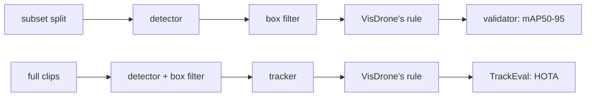

# Tuning: auto-labeling VisDrone-VID

These experiments choose the [auto-labeler](../autolabel.md)'s labeling config. Experiment 1 picks
the box detector and experiment 2 the box tracker. Experiment 3 checks once whether a video tracker
beats that box tracker. The winner becomes `AutolabelSettings`' defaults. Nothing is trained in a
labeling trial. The effort ends when YOLO26 s trained on auto-labels has been read once on test,
beside YOLO26 s trained on ground truth.

## How the experiments work

- **Data.** The subset (`visdrone-vid-small`) only. Train tunes, val checks that a winner holds on
  new footage, and test is read once, at the end, by YOLO trained on auto-labels.
  - A trial without a tracker labels a subset split's frames.
  - A trial with a tracker labels the full raw clips behind the split's sequences (no frame
    stride). Train clips tune, val clips check.
- **VisDrone's ignored-region rule.** A ground-truth box or auto-label with at least half its area
  inside the frame's ignored regions is dropped before scoring, as VisDrone's own toolkit does.
  Ignored regions are crowds and distant traffic the annotators left unlabeled. A zero-shot
  detector fires there, and the repo's own rule would count that as false positives.

  | | Repo (training, tuning, evaluation) | Labeling trials |
  |---|---|---|
  | Ground truth inside ignored regions | kept | dropped when ≥ half its area is inside |
  | Predictions inside ignored regions | kept (a hit is a false positive) | dropped by the same rule |

  **These scores don't compare with [YOLO26 tuning](yolo26-visdrone-vid.md) or
  [evaluation](../evaluation.md).** The ground truth lives in extra subset splits,
  `images/train-visdrone-rule` and `images/val-visdrone-rule` (labels alongside). They link the
  subset's frames, and their labels drop 782 of train's 57,030 boxes and 82 of val's 5,902.
- **Scores.**
  - Labels rank on **mAP50-95**, through ultralytics' validator (`score_detections`), with mAP50
    and mAP75 beside it. The detector keeps its top 300 boxes above 0.001, so every box is
    scored.
  - Trackers rank on **HOTA** (TrackEval, per merged class, det-averaged), with DetA, AssA, IDF1
    and ID switches beside it.
  - F1 never selects. The confidence floor decides which auto-labels are kept, and P and R are
    read at it. Each row is also scored on the frames where no raw category has more than 200
    boxes (`uncapped200`), SAM 3's per-prompt cap.
- **Win margin: 0.5 pt**, as in YOLO tuning. A rerun gives the same score, so there is no noise
  floor to measure.
- **Stages.** A stage file lists its trials. `defaults` apply to every trial, section by section,
  and a knob no file sets is production's (`AutolabelSettings`). A trial logs to the MLflow
  experiment `aerial-auto-label`, as `<stage>-<trial>-<split>`, with its boxes as VisDrone-VID
  annotation files under the artifact `annotations/`.
- **Stored detector passes.** A run over a whole frame set stores the detector's raw boxes in
  `runs/autolabel/detections/<frames>-<hash of the detector settings>.npz`. A later trial with the
  same detector reads them and reruns only the merge and the box filter.
- **Video trackers** (EdgeTAM, SAM 2.1 video) run the detector every K-th frame and carry objects
  between those frames. Each mask leaves the tracker only as its tight box.
- **Latency** is batch 1 per frame, decoded image to boxes, with the first 3 frames left out.



## How to run

`.env` sets `DATA__RAW_DIR` (raw VisDrone-VID, for the ignored regions and the full clips) and
`DATA__SUBSET_DIR`; see [data](../data.md).

```bash
uv run python -m mlops_cv.tuning.visdrone_vid   # builds train- and val-visdrone-rule
uv run --env-file .env python -m mlops_cv.tuning.label_eval \
  configs/tuning/autolabel-visdrone-vid/detector.yaml --split train
```

`--limit N` keeps the first N frames and `--sequence NAME` (repeatable) only those sequences.
Stage files are in `configs/tuning/autolabel-visdrone-vid/`:

```yaml
defaults:
  detector: {model: facebook/sam3, dtype: float16}
  box_filter: {nms_iou: null}
trials:
  - {name: nms-off}
  - {name: nms0.5, box_filter: {nms_iou: 0.5}}
```

### Viewing a trial

The annotation editor is FiftyOne 1.22.1 (`docker-compose/docker-compose.fiftyone.yml`), with raw
VisDrone-VID and `runs/autolabel/` mounted read-only at their host paths.

```bash
make fiftyone-up                        # http://localhost:5151
make autolabel-view RUN=<MLflow run id> # a run in aerial-auto-label
```

- Each raw split is one dataset, `visdrone-vid-<split>`, with `ground_truth` and `ignored`. It grows
  by the frames each trial labels. A trial adds one field, named after its run, with each box's
  confidence, so the App's confidence filter applies. Reloading overwrites it.
- Each field gets FiftyOne's own TP/FP/FN flags at IoU 0.5, for browsing only: they count every
  confidence, so the scores come from the validator alone.

## 1. Box detector

_Not run yet._ GDINO-T, GDINO-B, OWLv2-B/16, YOLOE-26-L and SAM 3 on subset train.

## 2. Box tracker

_Not run yet._ BoT-SORT, TrackTrack and Hybrid-SORT on the train clips, ByteTrack as a baseline.

## 3. Video tracker confirmation

_Not run yet._ One EdgeTAM run on the val clips against experiment 2's winner.

## Summary

_Pending._
