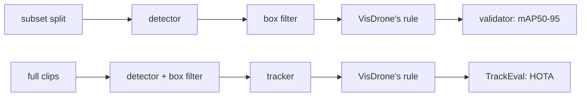

# Tuning: auto-labeling VisDrone-VID

These experiments choose the [auto-labeler](../autolabel.md)'s labeling config. Experiment 1 picks
the box detector and experiment 2 the box tracker. Experiment 3 checks once whether a video tracker
beats that box tracker. The winner becomes `AutolabelSettings`' defaults. Nothing is trained in a
labeling trial. The effort ends when YOLO26 s trained on auto-labels has been read once on test,
beside YOLO26 s trained on ground truth.

## How the experiments work

- **Data.** The subset (`visdrone-vid-small`) only. Train tunes, val checks that a winner holds on
  new footage, and test is read once, at the end, by YOLO trained on auto-labels.
  - A trial without a tracker labels a subset split's frames.
  - A trial with a tracker labels the full raw clips behind the split's sequences (no frame
    stride). Train clips tune, val clips check.
- **VisDrone's ignored-region rule.** A ground-truth box or auto-label with at least half its area
  inside the frame's ignored regions is dropped before scoring, as VisDrone's own toolkit does.
  Ignored regions are crowds and distant traffic the annotators left unlabeled. A zero-shot
  detector fires there, and the repo's own rule would count that as false positives.

  | | Repo (training, tuning, evaluation) | Labeling trials |
  |---|---|---|
  | Ground truth inside ignored regions | kept | dropped when ≥ half its area is inside |
  | Predictions inside ignored regions | kept (a hit is a false positive) | dropped by the same rule |

  **These scores don't compare with [YOLO26 tuning](yolo26-visdrone-vid.md) or
  [evaluation](../evaluation.md).** The ground truth lives in extra subset splits,
  `images/train-visdrone-rule` and `images/val-visdrone-rule` (labels alongside). They link the
  subset's frames, and their labels drop 782 of train's 57,030 boxes and 82 of val's 5,902.
- **Scores.**
  - Labels rank on **mAP50-95**, through ultralytics' validator (`score_detections`), with mAP50
    and mAP75 beside it. The detector keeps its top 300 boxes above 0.001, so every box is
    scored.
  - Trackers rank on **HOTA** (TrackEval, per merged class, det-averaged), with DetA, AssA, IDF1
    and ID switches beside it.
  - F1 never selects. The confidence floor decides which auto-labels are kept, and P and R are
    read at it. Each row is also scored on the frames where no raw category has more than 200
    boxes (`uncapped200`), SAM 3's per-prompt cap.
- **Win margin: 0.5 pt**, as in YOLO tuning. A rerun gives the same score, so there is no noise
  floor to measure.
- **Stages.** A stage file lists its trials. `defaults` apply to every trial, section by section,
  and a knob no file sets is production's (`AutolabelSettings`). A trial logs to the MLflow
  experiment `aerial-object-autolabel-tune`, as `<stage>-<trial>-<split>`, with its boxes as
  VisDrone-VID annotation files under the artifact `annotations/`.
- **Stored detector passes.** A run over a whole frame set stores the detector's raw boxes in
  `runs/autolabel/detections/<frames>-<hash of the detector settings>.npz`. A later trial with the
  same detector reads them and reruns only the merge and the box filter.
- **Video trackers** (EdgeTAM, SAM 2.1 video) run the detector every K-th frame and carry objects
  between those frames. Each mask leaves the tracker only as its tight box.
- **Latency** is batch 1 per frame, decoded image to boxes, with the first 3 frames left out.



## How to run

`.env` sets `DATA__RAW_DIR` (raw VisDrone-VID, for the ignored regions and the full clips) and
`DATA__SUBSET_DIR`; see [data](../data.md).

```bash
uv run python -m mlops_cv.tuning.autolabel_visdrone_vid.visdrone_vid   # builds train- and val-visdrone-rule
uv run --env-file .env python -m mlops_cv.tuning.autolabel_visdrone_vid.label_eval \
  configs/tuning/autolabel-visdrone-vid/detector.yaml --split train
```

`--limit N` keeps the first N frames and `--sequence NAME` (repeatable) only those sequences.
Stage files are in `configs/tuning/autolabel-visdrone-vid/`:

```yaml
defaults:
  detector: {model: facebook/sam3, dtype: float16}
  box_filter: {nms_iou: null}
trials:
  - {name: nms-off}
  - {name: nms0.5, box_filter: {nms_iou: 0.5}}
```

### Viewing a trial

The annotation editor is FiftyOne 1.22.1 (`docker-compose/docker-compose.fiftyone.yml`), with raw
VisDrone-VID and `runs/autolabel/` mounted read-only at their host paths.

```bash
make mlflow-up fiftyone-up  # the App on http://localhost:5151
# <run id>: a run in aerial-object-autolabel-tune
docker exec fiftyone python /opt/load_trial.py \
  $(uv run python -m mlops_cv.tuning.autolabel_visdrone_vid.view <run id>)
```

- Each raw split is one dataset, `visdrone-vid-<split>`, with `ground_truth` and `ignored`. It grows
  by the frames each trial labels. A trial adds one field, named after its run, with each box's
  confidence, so the App's confidence filter applies. Reloading overwrites it.
- Each field gets FiftyOne's own TP/FP/FN flags at IoU 0.5, for browsing only: they count every
  confidence, so the scores come from the validator alone.

## YOLO reference rows

YOLO26 trained on ground truth, on the scale that YOLO trained on auto-labels reads: the final
YOLO tuning recipe's `stage2-{n,s,m}1280` trials (`best.pt` from runs `4131a712`, `8567958a`,
`e8715d0c`), predicting val once at imgsz 1280 with val's floor and cap. The same predictions are
scored under both rules. The repo-rule column is the trial's `model.val` score, with this
predict-path score after the slash; the 0.1–0.3 pt gap is the padding difference described in
[YOLO26 tuning](yolo26-visdrone-vid.md#10-other-ways-to-run-the-same-weights-the-second-head-and-sahi).

```bash
uv run python -m mlops_cv.tuning.autolabel_visdrone_vid.rule_read stage2-n1280 stage2-s1280 stage2-m1280
```

Each trial logs `<trial>-val-visdrone-rule` to `aerial-object-autolabel-tune`, with
`val-visdrone-rule/` and `val/` (repo rule) keys.

| Model | repo rule mAP50-95 | VisDrone rule mAP50-95 | mAP50 | mAP75 |
|---|---|---|---|---|
| yolo26n | 28.4 / 28.5 | 29.0 | 57.0 | 25.9 |
| yolo26s | 30.8 / 30.5 | **31.1** | 61.5 | 27.2 |
| yolo26m | 32.9 / 32.6 | 33.5 | 66.3 | 29.3 |

VisDrone's rule lifts each size by 0.5–0.9 pt over the same predictions under the repo rule.

## 1. Box detector

### Stage 1: detector × prompts

**What:** GDINO-T, GDINO-B, OWLv2-B/16, YOLOE-26-L (at 640 and 1280) and SAM 3 on subset train,
each with the 10 raw names and with plain nouns. All in fp32, with production's box filter (NMS
0.5, no nested-box rule).

**Why:** picks the detector and prompts that the later stages tune. The top mAP50-95 wins, unless
a trial within the 0.5 pt margin is faster per frame (detector p50 ms); then the faster one wins.

```bash
uv run --env-file .env python -m mlops_cv.tuning.autolabel_visdrone_vid.label_eval \
  configs/tuning/autolabel-visdrone-vid/detector.yaml --split train
```

The person, vehicle and 2-3-wheeler columns are each merged class's mAP50-95. Max-F1 conf is the
confidence floor's candidate (it never selects), and kept / frame counts the boxes left after the
box filter, above 0.001.

| Trial | Run | mAP50-95 | mAP50 | mAP75 | person | vehicle | 2-3-wheeler | max-F1 conf | kept / frame | detector p50 ms |
|---|---|---|---|---|---|---|---|---|---|---|
| sam3-raw | 95f43253 | 25.0 | 59.5 | 17.0 | 16.9 | 41.2 | 16.8 | 0.594 | 146 | 1594 |
| **sam3-nouns** | 836be2c3 | 24.7 | 58.5 | 16.9 | 16.5 | 41.2 | 16.3 | 0.558 | 160 | 1424 |
| gdino-b-raw | cb644ea7 | 23.9 | 52.7 | 18.1 | 20.4 | 41.7 | 9.5 | 0.200 | 202 | 323 |
| gdino-t-raw | d2418a8c | 22.5 | 50.4 | 17.3 | 15.3 | 41.1 | 11.2 | 0.189 | 204 | 230 |
| gdino-t-nouns | 4444881a | 21.5 | 50.3 | 15.6 | 13.9 | 39.0 | 11.7 | 0.282 | 217 | 231 |
| gdino-b-nouns | b2d0fcf6 | 19.4 | 48.7 | 12.2 | 13.5 | 34.4 | 10.4 | 0.261 | 216 | 322 |
| yoloe-26l-1280-nouns | 63a05ac0 | 19.1 | 48.4 | 11.9 | 13.5 | 34.7 | 9.1 | 0.212 | 178 | 54 |
| yoloe-26l-1280-raw | 41999bef | 18.7 | 47.0 | 11.7 | 12.9 | 34.7 | 8.5 | 0.054 | 170 | 53 |
| owlv2-b16-nouns | cf4a2348 | 16.9 | 43.7 | 10.5 | 7.9 | 34.7 | 8.1 | 0.271 | 240 | 202 |
| yoloe-26l-nouns | f8cba2cf | 16.4 | 40.3 | 11.0 | 12.4 | 31.1 | 5.7 | 0.123 | 171 | 18 |
| owlv2-b16-raw | d59f2e37 | 15.9 | 40.1 | 10.4 | 6.7 | 34.6 | 6.4 | 0.281 | 242 | 208 |
| yoloe-26l-raw | 45ef672a | 15.5 | 37.7 | 10.6 | 9.7 | 31.0 | 5.8 | 0.053 | 158 | 18 |

**Result:**
- SAM 3 leads on both prompt sets. sam3-nouns is 0.3 pt behind sam3-raw and 11% faster per
  frame (8 prompts against 10), so **sam3-nouns wins**. gdino-b-raw is 0.8 pt behind it, at under
  a quarter of its time.
- The top 3 go to stage 2: sam3-raw, sam3-nouns and gdino-b-raw.
- No train frame has more than 200 boxes of one raw category, so the `uncapped200` score covers
  all 1,238 frames and equals mAP50-95 on every row.

### Stage 2: the box filter

**What:** stage 1's top 3 (sam3-raw, sam3-nouns, gdino-b-raw), each with NMS IoU {off, 0.5, 0.6,
0.7} × the nested-box rule {off, keep outer at IoS 0.8}; `min_side: 8` and `max_area: 0.05` stay
fixed. Every trial rescores the detector's stored stage 1 pass on CPU, so the NMS 0.5 /
nested-off rows repeat stage 1's.

**Why:** the box filter is tuned per detector. Each detector's winner so far is its stage 1 row,
and a setting replaces it only by the 0.5 pt margin. The best detector + filter then wins, with
stage 1's speed rule.

```bash
uv run --env-file .env python -m mlops_cv.tuning.autolabel_visdrone_vid.label_eval \
  configs/tuning/autolabel-visdrone-vid/box-filter.yaml --split train
```

Columns as in stage 1; the detector p50 ms are stage 1's (1594, 1424 and 323).

| Trial | Run | mAP50-95 | mAP50 | mAP75 | person | vehicle | 2-3-wheeler | max-F1 conf | kept / frame |
|---|---|---|---|---|---|---|---|---|---|
| sam3-raw-nms-off-nested-off | 34f11df0 | 25.4 | 60.2 | 17.3 | 17.1 | 41.5 | 17.6 | 0.626 | 271 |
| sam3-raw-nms0.7-nested-off | 5a0d4c3e | 25.4 | 60.6 | 17.1 | 17.3 | 41.3 | 17.5 | 0.596 | 179 |
| sam3-raw-nms0.6-nested-off | aeaa0353 | 25.2 | 60.1 | 17.0 | 17.1 | 41.2 | 17.2 | 0.595 | 162 |
| sam3-raw-nms0.5-nested-off | 76028050 | 25.0 | 59.5 | 17.0 | 16.9 | 41.2 | 16.8 | 0.594 | 146 |
| sam3-raw-nms0.5-outer | 7675e2b0 | 24.1 | 57.0 | 16.7 | 15.0 | 40.9 | 16.5 | 0.580 | 114 |
| sam3-raw-nms0.6-outer | a0037ff4 | 24.0 | 56.7 | 16.6 | 14.7 | 40.9 | 16.5 | 0.578 | 115 |
| sam3-raw-nms0.7-outer | 1c0c5a9a | 23.9 | 56.2 | 16.6 | 14.2 | 40.9 | 16.5 | 0.574 | 115 |
| sam3-raw-nms-off-outer | bb435b1c | 20.9 | 49.3 | 14.6 | 11.7 | 38.1 | 13.0 | 0.336 | 114 |
| **sam3-nouns-nms-off-nested-off** | 5968a1a9 | 25.3 | 60.0 | 17.3 | 16.8 | 41.6 | 17.5 | 0.580 | 277 |
| sam3-nouns-nms0.7-nested-off | a504c522 | 25.1 | 59.8 | 17.1 | 16.8 | 41.5 | 17.1 | 0.559 | 197 |
| sam3-nouns-nms0.6-nested-off | c45591fe | 25.0 | 59.3 | 17.0 | 16.7 | 41.4 | 16.8 | 0.559 | 179 |
| sam3-nouns-nms0.5-nested-off | 24bb3e60 | 24.7 | 58.5 | 16.9 | 16.5 | 41.2 | 16.3 | 0.558 | 160 |
| sam3-nouns-nms0.5-outer | 557c4cdd | 24.0 | 56.5 | 16.7 | 15.3 | 40.9 | 15.8 | 0.543 | 124 |
| sam3-nouns-nms0.6-outer | ab74b573 | 23.9 | 56.2 | 16.7 | 15.0 | 40.9 | 15.9 | 0.539 | 127 |
| sam3-nouns-nms0.7-outer | 2cb5ff90 | 23.8 | 55.6 | 16.7 | 14.6 | 40.8 | 15.9 | 0.533 | 127 |
| sam3-nouns-nms-off-outer | 27ce96fa | 20.8 | 48.9 | 14.3 | 13.6 | 37.1 | 11.6 | 0.388 | 126 |
| gdino-b-raw-nms-off-nested-off | 9666fdb5 | 24.5 | 53.4 | 18.7 | 20.9 | 42.0 | 10.5 | 0.218 | 284 |
| gdino-b-raw-nms0.7-nested-off | 986bc038 | 24.4 | 53.8 | 18.4 | 20.8 | 42.1 | 10.3 | 0.206 | 244 |
| gdino-b-raw-nms0.6-nested-off | feb2cd0c | 24.2 | 53.5 | 18.2 | 20.7 | 41.9 | 10.0 | 0.204 | 226 |
| gdino-b-raw-nms0.5-nested-off | 7dc32cd1 | 23.9 | 52.7 | 18.1 | 20.4 | 41.7 | 9.5 | 0.200 | 202 |
| gdino-b-raw-nms0.5-outer | 272366f9 | 11.4 | 23.3 | 9.8 | 6.0 | 21.7 | 6.6 | 0.153 | 68 |
| gdino-b-raw-nms0.6-outer | 78dbf6f1 | 10.7 | 21.7 | 9.3 | 5.1 | 20.9 | 6.0 | 0.143 | 66 |
| gdino-b-raw-nms0.7-outer | e302a682 | 10.1 | 20.4 | 9.0 | 4.6 | 20.6 | 5.2 | 0.134 | 65 |
| gdino-b-raw-nms-off-outer | e02e2159 | 8.9 | 18.0 | 8.1 | 3.8 | 19.1 | 3.9 | 0.104 | 64 |

**Result:**
- Looser NMS scores higher on every detector, and NMS off is each one's top. The nested-box rule
  costs 0.7–4.5 pt on SAM 3 and 12–16 pt on GDINO-B (it keeps a quarter of GDINO-B's boxes).
- **Best filter per detector:** sam3-raw keeps NMS 0.5 (NMS off is 0.41 pt up, under the margin);
  sam3-nouns and gdino-b-raw take NMS off (+0.59 and +0.58 pt).
- **sam3-nouns with NMS off wins** (25.3): it tops the three detectors' best filters and is the
  faster SAM 3. sam3-raw at NMS 0.5 is 0.30 pt behind, gdino-b-raw with NMS off 0.81 pt.
- NMS off keeps almost every box (277 per frame against 160) and lowers P and R at the max-F1
  point slightly (0.646 / 0.632 against 0.655 / 0.637): the gain is in the low-confidence tail.

## 2. Box tracker

_Not run yet._ BoT-SORT, TrackTrack and Hybrid-SORT on the train clips, ByteTrack as a baseline.

## 3. Video tracker confirmation

_Not run yet._ One EdgeTAM run on the val clips against experiment 2's winner.

## Summary

_Pending._
