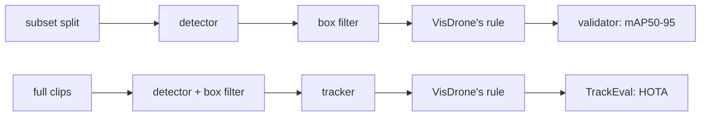

# Tuning: auto-labeling VisDrone-VID

These experiments choose the [auto-labeler](../autolabel.md)'s labeling config. Experiment 1 picks
the box detector and experiment 2 the box tracker. Experiment 3 checks once whether a video tracker
beats that box tracker. The winner becomes `AutolabelSettings`' defaults. Nothing is trained in a
labeling trial. The effort ends when YOLO26 s trained on auto-labels has been read once on test,
beside YOLO26 s trained on ground truth.

## How the experiments work

- **Data.** The subset (`visdrone-vid-small`) only. Train tunes, val checks that a winner holds on
  new footage, and test is read once, at the end, by YOLO trained on auto-labels.
  - A trial without a tracker labels a subset split's frames.
  - A trial with a tracker labels the full raw clips behind the split's sequences (no frame
    stride). Train clips tune, val clips check.
- **VisDrone's ignored-region rule.** A ground-truth box or auto-label with at least half its area
  inside the frame's ignored regions is dropped before scoring, as VisDrone's own toolkit does.
  Ignored regions are crowds and distant traffic the annotators left unlabeled. A zero-shot
  detector fires there, and the repo's own rule would count that as false positives.

  | | Repo (training, tuning, evaluation) | Labeling trials |
  |---|---|---|
  | Ground truth inside ignored regions | kept | dropped when ≥ half its area is inside |
  | Predictions inside ignored regions | kept (a hit is a false positive) | dropped by the same rule |

  **These scores don't compare with [YOLO26 tuning](yolo26-visdrone-vid.md) or
  [evaluation](../evaluation.md).** The ground truth lives in extra subset splits,
  `images/{train,val,test}-visdrone-rule` (labels alongside). They link the subset's frames, and
  their labels drop 782 of train's 57,030 boxes, 82 of val's 5,902 and 296 of test's 15,763.
  Labeling trials score on train and val only; test's copy is read once, by YOLO.
- **Scores.**
  - Labels rank on **mAP50-95**, through ultralytics' validator (`score_detections`), with mAP50
    and mAP75 beside it. The detector keeps its top 300 boxes above 0.001, so every box is
    scored.
  - Trackers rank on **HOTA** (TrackEval, per merged class, det-averaged), with DetA, AssA, IDF1
    and ID switches beside it, over every clip frame.
  - **Label mAP50-95** (tracker tables only, reported, never selecting) is the same validator
    score on a tracker trial's tracked boxes, on the subset frames inside the clips
    (`subset/<split>/` keys): the frames, and so the labels, YOLO trains on. A tracker keeps only
    boxes that start or continue a track, which cuts them near the floor, while the detector
    stages score every box down to 0.001. Compare it with the detector's own score at the floor:
    Experiment 2 stage 1's `detector, untracked, at the floor`.
  - `ground_truth: true` runs a box tracker on the clips' ground-truth boxes (score 1.0) instead
    of the detector's: the association ceiling, never selecting.
  - F1 never selects. The confidence floor decides which auto-labels are kept, and P and R are
    read at it. Each row is also scored on the frames where no raw category has more than 200
    boxes (`uncapped200`), SAM 3's per-prompt cap.
- **Win margin: 0.5 pt**, as in YOLO tuning. A rerun gives the same score, so there is no noise
  floor to measure.
- **Stages.** A stage file lists its trials. `defaults` apply to every trial, section by section,
  and a knob no file sets is production's (`AutolabelSettings`). A trial logs to the MLflow
  experiment `aerial-object-autolabel-tune`, as `<stage>-<trial>-<split>`, with its boxes as
  VisDrone-VID annotation files under the artifact `annotations/`.
- **Stored detector passes.** A run over a whole frame set stores the detector's raw boxes in
  `runs/autolabel/detections/<frames>-<hash of the detector settings>.npz`. A later trial with the
  same detector reads them and reruns only the merge and the box filter.
- **Box trackers** (ultralytics') run through the production labeler's tracking code
  (`mlops_cv.autolabel`), each clip in its own fresh (forkserver) process, 16 at a time.
  `tracker.overrides` sets keys of the tracker's ultralytics YAML; a key the YAML lacks, or one the
  confidence floor sets, fails the trial. `labeler.yaml` is production's config, tracker included.
- **Video trackers** (EdgeTAM, SAM 2.1 S, SAM 3's tracker) run the detector every K-th frame
  and carry objects between those frames. Each mask leaves the tracker only as its tight box.
- **Latency** is batch 1 per frame, decoded image to boxes, with the first 3 frames left out.
- **Hardware:** the laptop in [YOLO26 tuning](yolo26-visdrone-vid.md#hardware) (RTX 5070 Laptop
  8 GB, Core Ultra 9 275HX with 24 cores). GPU times and latencies hold for it alone.



## How to run

`.env` sets `DATA__RAW_DIR` (raw VisDrone-VID, for the ignored regions and the full clips) and
`DATA__SUBSET_DIR`; see [data](../data.md).
Packages only the trials need stay off the lock, pinned in each stage's command (`uv run --with`):
YOLOE-26's text encoder (ultralytics' CLIP fork, which ultralytics pip-installs unpinned
otherwise), TrackEval for the tracker stages, and timm for EdgeTAM's RepViT backbone.

```bash
uv run python -m mlops_cv.tuning.autolabel_visdrone_vid.visdrone_vid   # builds {train,val,test}-visdrone-rule
uv run --env-file .env --with "clip @ git+https://github.com/ultralytics/CLIP.git@7ffa84b3bfa40c42ecc1c77147a855e69cb2dd40" python -m mlops_cv.tuning.autolabel_visdrone_vid.label_eval \
  configs/tuning/autolabel-visdrone-vid/detector.yaml --split train
```

`--limit N` keeps the first N frames, `--every N` every N-th frame (a sample across sequences)
and `--sequence NAME` (repeatable) only those sequences.
Stage files are in `configs/tuning/autolabel-visdrone-vid/`:

```yaml
defaults:
  detector: {model: facebook/sam3, dtype: float16}
  box_filter: {nms_iou: null}
trials:
  - {name: nms-off}
  - {name: nms0.5, box_filter: {nms_iou: 0.5}}
```

### Viewing a trial

The annotation editor is FiftyOne 1.22.1 (`docker-compose/docker-compose.fiftyone.yml`), with raw
VisDrone-VID and `runs/autolabel/` mounted read-only at their host paths.

```bash
make mlflow-up fiftyone-up  # the App on http://localhost:5151
# <run id>: a run in aerial-object-autolabel-tune
docker exec fiftyone python /opt/load_trial.py \
  $(uv run python -m mlops_cv.tuning.autolabel_visdrone_vid.view <run id>)
```

- Each raw split is one dataset, `visdrone-vid-<split>`, with `ground_truth` and `ignored`. It grows
  by the frames each trial labels. A trial adds one field, named after its run, with each box's
  confidence, so the App's confidence filter applies. Reloading overwrites it.
- Each field gets FiftyOne's own TP/FP/FN flags at IoU 0.5, for browsing only: they count every
  confidence, so the scores come from the validator alone.

## YOLO reference rows

YOLO26 trained on ground truth, on the scale that YOLO trained on auto-labels reads: the final
YOLO tuning recipe's `stage2-{n,s,m}1280` trials (their `best.pt`), predicting val once at imgsz 1280 with val's floor and cap. The same predictions are
scored under both rules. The repo-rule column is the trial's `model.val` score, with this
predict-path score (`model.predict()`) after the slash; the 0.1–0.3 pt gap is the padding difference described in
[YOLO26 tuning](yolo26-visdrone-vid.md#10-other-ways-to-run-the-same-weights-the-second-head-and-sahi).

```bash
uv run python -m mlops_cv.tuning.autolabel_visdrone_vid.rule_read stage2-n1280 stage2-s1280 stage2-m1280
```

Each trial logs `<trial>-val-visdrone-rule` to `aerial-object-autolabel-tune`, with
`val-visdrone-rule/` and `val/` (repo rule) keys.

| Model | repo rule mAP50-95 | VisDrone rule mAP50-95 | mAP50 | mAP75 |
|---|---|---|---|---|
| yolo26n | 28.4 / 28.5 | 29.0 | 57.0 | 25.9 |
| yolo26s | 30.8 / 30.5 | **31.1** | 61.5 | 27.2 |
| yolo26m | 32.9 / 32.6 | 33.5 | 66.3 | 29.3 |

VisDrone's rule lifts each size by 0.5–0.9 pt over the same predictions under the repo rule.

## 1. Box detector

### Stage 1: detector × prompts

**What:** GDINO-T, GDINO-B, OWLv2-B/16, YOLOE-26-L (at 640 and 1280) and SAM 3 on subset train,
each with the 10 raw names and with plain nouns. All in fp32, with the box filter production had
then (NMS 0.5, no nested-box rule). The two prompt sets, each prompt mapped to its merged class:

| Merged class | raw (VisDrone's 10 category names) | nouns (8 plain nouns) |
|---|---|---|
| person | `pedestrian`, `people` | `person` |
| vehicle | `car`, `van`, `truck`, `bus` | `car`, `van`, `truck`, `bus` |
| two-three-wheeler | `bicycle`, `tricycle`, `awning-tricycle`, `motor` | `bicycle`, `motorcycle`, `tricycle` |

A raw prompt names a VisDrone category, so its auto-labels keep that raw category. A noun that
names none (`person`, `motorcycle`) takes the lowest raw category of its merged class.

**Why:** picks the detector and prompts that the later stages tune. The top mAP50-95 wins, unless
another detector within the 0.5 pt margin is faster per frame (detector p50 ms); then the faster
one wins.

```bash
uv run --env-file .env --with "clip @ git+https://github.com/ultralytics/CLIP.git@7ffa84b3bfa40c42ecc1c77147a855e69cb2dd40" python -m mlops_cv.tuning.autolabel_visdrone_vid.label_eval \
  configs/tuning/autolabel-visdrone-vid/detector.yaml --split train
```

The person, vehicle and 2-3-wheeler columns are each merged class's mAP50-95. Max-F1 conf is the
confidence floor's candidate (it never selects), and kept / frame counts the boxes left after the
box filter, above 0.001.

| Trial | mAP50-95 | mAP50 | mAP75 | person AP50-95 | vehicle AP50-95 | 2-3-wheeler AP50-95 | max-F1 conf | kept / frame | detector p50 ms |
|---|---|---|---|---|---|---|---|---|---|
| **sam3-raw** | 25.0 | 59.5 | 17.0 | 16.9 | 41.2 | 16.8 | 0.594 | 146 | 1594 |
| sam3-nouns | 24.7 | 58.5 | 16.9 | 16.5 | 41.2 | 16.3 | 0.558 | 160 | 1424 |
| gdino-b-raw | 23.9 | 52.7 | 18.1 | 20.4 | 41.7 | 9.5 | 0.200 | 202 | 323 |
| gdino-t-raw | 22.5 | 50.4 | 17.3 | 15.3 | 41.1 | 11.2 | 0.189 | 204 | 230 |
| gdino-t-nouns | 21.5 | 50.3 | 15.6 | 13.9 | 39.0 | 11.7 | 0.282 | 217 | 231 |
| gdino-b-nouns | 19.4 | 48.7 | 12.2 | 13.5 | 34.4 | 10.4 | 0.261 | 216 | 322 |
| yoloe-26l-1280-nouns | 19.1 | 48.4 | 11.9 | 13.5 | 34.7 | 9.1 | 0.212 | 178 | 54 |
| yoloe-26l-1280-raw | 18.7 | 47.0 | 11.7 | 12.9 | 34.7 | 8.5 | 0.054 | 170 | 53 |
| owlv2-b16-nouns | 16.9 | 43.7 | 10.5 | 7.9 | 34.7 | 8.1 | 0.271 | 240 | 202 |
| yoloe-26l-nouns | 16.4 | 40.3 | 11.0 | 12.4 | 31.1 | 5.7 | 0.123 | 171 | 18 |
| owlv2-b16-raw | 15.9 | 40.1 | 10.4 | 6.7 | 34.6 | 6.4 | 0.281 | 242 | 208 |
| yoloe-26l-raw | 15.5 | 37.7 | 10.6 | 9.7 | 31.0 | 5.8 | 0.053 | 158 | 18 |

**Result:**
- **sam3-raw wins.** SAM 3 leads on both prompt sets; nouns are 0.3 pt behind and 11% faster
  (8 prompts against 10), a setting of the same detector. gdino-b-raw is 1.1 pt behind, at a fifth
  of its time.
- The top 3 go to stage 2: sam3-raw, sam3-nouns and gdino-b-raw.
- No train frame has more than 200 boxes of one raw category, so the `uncapped200` score covers
  all 1,238 frames and equals mAP50-95 on every row.

### Stage 2: the box filter

**What:** stage 1's top 3 (sam3-raw, sam3-nouns, gdino-b-raw), each with NMS IoU {off, 0.5, 0.6,
0.7} × the nested-box rule {off, keep outer at IoS 0.8}; `min_side: 8` and `max_area: 0.05` stay
fixed. Keep inner is left out (8–11 pt down on both detectors the earlier effort tried). Every
trial rescores the detector's stored stage 1 pass on CPU, so the NMS 0.5 / nested-off rows
repeat stage 1's.

**Why:** the box filter is tuned per detector. SAM 3's winner so far is sam3-raw's stage 1 row
(nouns are one of its settings), GDINO-B's is its own, and a setting replaces it only by the
0.5 pt margin. The detectors' best filters then meet in
the fp16 check.

```bash
uv run --env-file .env python -m mlops_cv.tuning.autolabel_visdrone_vid.label_eval \
  configs/tuning/autolabel-visdrone-vid/box-filter.yaml --split train
```

Columns as in stage 1; the detector p50 ms are stage 1's (1594, 1424 and 323).

| Trial | mAP50-95 | mAP50 | mAP75 | person AP50-95 | vehicle AP50-95 | 2-3-wheeler AP50-95 | max-F1 conf | kept / frame |
|---|---|---|---|---|---|---|---|---|
| sam3-raw-nms-off-nested-off | 25.4 | 60.2 | 17.3 | 17.1 | 41.5 | 17.6 | 0.626 | 271 |
| sam3-raw-nms0.7-nested-off | 25.4 | 60.6 | 17.1 | 17.3 | 41.3 | 17.5 | 0.596 | 179 |
| sam3-raw-nms0.6-nested-off | 25.2 | 60.1 | 17.0 | 17.1 | 41.2 | 17.2 | 0.595 | 162 |
| **sam3-raw-nms0.5-nested-off** | 25.0 | 59.5 | 17.0 | 16.9 | 41.2 | 16.8 | 0.594 | 146 |
| sam3-raw-nms0.5-outer | 24.1 | 57.0 | 16.7 | 15.0 | 40.9 | 16.5 | 0.580 | 114 |
| sam3-raw-nms0.6-outer | 24.0 | 56.7 | 16.6 | 14.7 | 40.9 | 16.5 | 0.578 | 115 |
| sam3-raw-nms0.7-outer | 23.9 | 56.2 | 16.6 | 14.2 | 40.9 | 16.5 | 0.574 | 115 |
| sam3-raw-nms-off-outer | 20.9 | 49.3 | 14.6 | 11.7 | 38.1 | 13.0 | 0.336 | 114 |
| sam3-nouns-nms-off-nested-off | 25.3 | 60.0 | 17.3 | 16.8 | 41.6 | 17.5 | 0.580 | 277 |
| sam3-nouns-nms0.7-nested-off | 25.1 | 59.8 | 17.1 | 16.8 | 41.5 | 17.1 | 0.559 | 197 |
| sam3-nouns-nms0.6-nested-off | 25.0 | 59.3 | 17.0 | 16.7 | 41.4 | 16.8 | 0.559 | 179 |
| sam3-nouns-nms0.5-nested-off | 24.7 | 58.5 | 16.9 | 16.5 | 41.2 | 16.3 | 0.558 | 160 |
| sam3-nouns-nms0.5-outer | 24.0 | 56.5 | 16.7 | 15.3 | 40.9 | 15.8 | 0.543 | 124 |
| sam3-nouns-nms0.6-outer | 23.9 | 56.2 | 16.7 | 15.0 | 40.9 | 15.9 | 0.539 | 127 |
| sam3-nouns-nms0.7-outer | 23.8 | 55.6 | 16.7 | 14.6 | 40.8 | 15.9 | 0.533 | 127 |
| sam3-nouns-nms-off-outer | 20.8 | 48.9 | 14.3 | 13.6 | 37.1 | 11.6 | 0.388 | 126 |
| gdino-b-raw-nms-off-nested-off | 24.5 | 53.4 | 18.7 | 20.9 | 42.0 | 10.5 | 0.218 | 284 |
| gdino-b-raw-nms0.7-nested-off | 24.4 | 53.8 | 18.4 | 20.8 | 42.1 | 10.3 | 0.206 | 244 |
| gdino-b-raw-nms0.6-nested-off | 24.2 | 53.5 | 18.2 | 20.7 | 41.9 | 10.0 | 0.204 | 226 |
| gdino-b-raw-nms0.5-nested-off | 23.9 | 52.7 | 18.1 | 20.4 | 41.7 | 9.5 | 0.200 | 202 |
| gdino-b-raw-nms0.5-outer | 11.4 | 23.3 | 9.8 | 6.0 | 21.7 | 6.6 | 0.153 | 68 |
| gdino-b-raw-nms0.6-outer | 10.7 | 21.7 | 9.3 | 5.1 | 20.9 | 6.0 | 0.143 | 66 |
| gdino-b-raw-nms0.7-outer | 10.1 | 20.4 | 9.0 | 4.6 | 20.6 | 5.2 | 0.134 | 65 |
| gdino-b-raw-nms-off-outer | 8.9 | 18.0 | 8.1 | 3.8 | 19.1 | 3.9 | 0.104 | 64 |

**Result:**
- Without the nested-box rule, looser NMS scores higher on every detector: NMS off tops each
  (sam3-raw's NMS 0.7 ties it). The rule reverses that order and costs 0.7–4.5 pt on SAM 3 and
  12–16 pt on GDINO-B, where it keeps only a quarter to a third of the boxes.
- **SAM 3 keeps sam3-raw with NMS 0.5** (25.0): no SAM 3 setting beats it by 0.5 pt (raw with
  NMS off +0.41, nouns with NMS off +0.30). **GDINO-B takes NMS off** (+0.58), 0.502 pt behind
  SAM 3: just outside the margin in fp32.
- On sam3-nouns, NMS off keeps almost every box (277 per frame against 160) and lowers P and R
  at the max-F1 point slightly (0.646 / 0.632 against 0.655 / 0.637): the gain is in the
  low-confidence tail.

### fp16 check

**What:** stage 2's three detectors in fp16, each with NMS 0.5 and NMS off (no nested-box rule).
SAM 3 loads half weights; GDINO runs under autocast, since transformers' GDINO fails in pure fp16.

**Why:** production runs fp16, and the speed rule weighs latency, so the detectors compare at that
precision: GDINO-B wins if its winner so far is within 0.5 pt of SAM 3's and faster.

```bash
uv run --env-file .env python -m mlops_cv.tuning.autolabel_visdrone_vid.label_eval \
  configs/tuning/autolabel-visdrone-vid/fp16.yaml --split train
```

| Trial | fp32 mAP50-95 | fp16 mAP50-95 | mAP50 | mAP75 | max-F1 conf | kept / frame | detector p50 ms (fp32 → fp16) |
|---|---|---|---|---|---|---|---|
| sam3-raw-fp16-nms0.5 | 24.97 | 24.86 | 59.2 | 16.8 | 0.593 | 145 | 1594 → 481 |
| sam3-raw-fp16-nms-off | 25.38 | 25.28 | 59.8 | 17.2 | 0.625 | 269 | 1594 → 481 |
| sam3-nouns-fp16-nms0.5 | 24.68 | 24.60 | 58.3 | 16.9 | 0.559 | 160 | 1424 → 429 |
| sam3-nouns-fp16-nms-off | 25.28 | 25.23 | 59.9 | 17.3 | 0.580 | 275 | 1424 → 429 |
| gdino-b-raw-fp16-nms0.5 | 23.89 | 23.89 | 52.7 | 18.1 | 0.200 | 202 | 323 → 200 |
| **gdino-b-raw-fp16-nms-off** | 24.47 | 24.46 | 53.3 | 18.7 | 0.218 | 284 | 323 → 200 |

**Result:**
- fp16 costs at most 0.11 pt and cuts SAM 3's time 3.3×, GDINO-B's 1.6×. Later stages run fp16.
- **gdino-b-raw with NMS off is the winner so far:** 0.40 pt behind sam3-raw at NMS 0.5 and 2.4×
  faster. It is weaker on two-three-wheelers (10.5 against 16.8 AP in fp32), where tiling may
  help most, so stage 3 tiles both.

### Stage 3: tiling

**What:** each detector's winner so far (gdino-b-raw + NMS off, sam3-raw + NMS 0.5) in fp16,
on slices plus the full frame at zoom 1.25, merged by the edge rule or the contained merge (a
CPU rescore of the same passes). The untiled rows are the fp16 check's. Zoom 2 runs only if a
zoom 1.25 row beats its untiled row by 0.5 pt.

**Why:** tiling enlarges small objects, and GDINO-B is weak on two-three-wheelers. Each
detector's best tiled row replaces its untiled row only by 0.5 pt; then the per-model tie rule
in fp16 (SAM 3 wins only by 0.5 pt over GDINO-B).

**Zoom** is the detector's input side over the slice side, the magnification of a slice's
pixels. SAM 3 squashes every pass to a 1008 square: 806 px slices at 1.25, 504 at 2. GDINO-B's
processor resizes the shortest edge to 800 (longest capped at 1333), so a square slice enters at
800 × 800: 640 px slices at 1.25, 400 at 2. SAM 3's 806 px slices would be GDINO-B's zoom 0.99.

```bash
uv run --env-file .env python -m mlops_cv.tuning.autolabel_visdrone_vid.label_eval \
  configs/tuning/autolabel-visdrone-vid/tiling.yaml --split train
```

| Trial | mAP50-95 | mAP50 | mAP75 | person AP50-95 | vehicle AP50-95 | 2-3-wheeler AP50-95 | max-F1 conf | kept / frame | detector p50 ms |
|---|---|---|---|---|---|---|---|---|---|
| **gdino-b-raw-fp16-nms-off** (untiled) | 24.46 | 53.3 | 18.8 | 20.9 | 41.9 | 10.5 | 0.218 | 284 | 200 |
| gdino-b-raw-nms-off-zoom1.25 | 24.94 | 56.8 | 18.3 | 19.7 | 42.0 | 13.1 | 0.302 | 1041 | 1314 |
| gdino-b-raw-nms-off-zoom1.25-contained | 23.24 | 53.7 | 16.6 | 19.3 | 37.9 | 12.5 | 0.303 | 1024 | 1314 |
| sam3-raw-fp16-nms0.5 (untiled) | 24.86 | 59.2 | 16.8 | 16.8 | 41.1 | 16.7 | 0.593 | 145 | 481 |
| sam3-raw-nms0.5-zoom1.25 | 25.24 | 59.9 | 17.5 | 16.8 | 42.3 | 16.6 | 0.721 | 480 | 3388 |
| sam3-raw-nms0.5-zoom1.25-contained | 24.69 | 59.0 | 16.9 | 16.6 | 41.2 | 16.3 | 0.723 | 482 | 3388 |

**Result:**
- **No tiled row clears the margin:** GDINO-B at zoom 1.25 is +0.48 (two-three-wheelers +2.6,
  person −1.2) at 6.6× the detector time; SAM 3 is +0.38 at 7×. Zoom 2 was stopped unrun.
- **The edge rule beats the contained merge** on both (by 1.7 and 0.55 pt). The contained merge
  first ran with every nested same-class box treated as a cut-off piece, so GDINO-B's
  frame-sized group boxes swallowed the objects (1.75); it now joins only slice-cut boxes.
- **gdino-b-raw + NMS off, untiled, stays the winner** (24.46, max-F1 conf 0.218), 0.40 pt
  behind SAM 3 and 2.4× faster. **Runner-up for stage 4's val check:** sam3-raw + NMS 0.5,
  untiled (24.86, max-F1 conf 0.593).

### Large GDINO probe

**What:** MM-GDINO-L (`openmmlab-community/mm_grounding_dino_large_all`) and LLMDet-L
(`iSEE-Laboratory/llmdet_large`), Swin-L and neither trained on VisDrone, raw names, NMS off,
fp16, on every 12th train frame (104 frames). A full frame (1333 × 750 in)
runs out of 8 GB in transformers' deformable attention (≈ 83k encoder tokens; an 800 × 800 slice
peaks at 5.1 GB), so they run at zoom 1.25 on 640 px slices without the full-frame pass, beside
GDINO-B the same way. The other rows rescore stored passes of the same frames.

**Why:** a Larger model would replace GDINO-B.

```bash
uv run --env-file .env python -m mlops_cv.tuning.autolabel_visdrone_vid.label_eval \
  configs/tuning/autolabel-visdrone-vid/gdino-large-probe.yaml --split train --every 12
```

| Trial | mAP50-95 | mAP50 | mAP75 | person AP50-95 | vehicle AP50-95 | 2-3-wheeler AP50-95 | max-F1 conf | kept / frame | detector p50 ms |
|---|---|---|---|---|---|---|---|---|---|
| gdino-b-raw-nms-off | 24.34 | 53.5 | 18.6 | 20.9 | 42.9 | 9.3 | 0.214 | 285 | 200 |
| sam3-raw-nms0.5 | 24.66 | 58.1 | 16.9 | 16.7 | 41.8 | 15.5 | 0.609 | 146 | 481 |
| gdino-b-raw-nms-off-zoom1.25 | 24.87 | 57.0 | 18.0 | 19.3 | 42.8 | 12.5 | 0.309 | 1022 | 1316 |
| gdino-b-raw-nms-off-zoom1.25-slices | 24.72 | 56.6 | 17.8 | 19.2 | 42.5 | 12.4 | 0.307 | 971 | 1113 |
| mm-gdino-l-raw-nms-off-zoom1.25-slices | 22.76 | 54.4 | 15.7 | 16.6 | 40.2 | 11.4 | 0.335 | 1062 | 4035 |
| llmdet-l-raw-nms-off-zoom1.25-slices | 21.74 | 52.0 | 15.1 | 16.0 | 39.7 | 9.5 | 0.352 | 1025 | 4037 |

**Result:**
- **Both Large models trail GDINO-B's zoom 1.25 edge row**, by 2.1 and 3.1 pt (2.0 and 3.0 on
  the same slices), at 3.6× its time: the check is closed. The probe frames keep the full split's order (GDINO-B 24.34, SAM 3 24.66).
- transformers 5.8 ties MM-GDINO's per-layer decoder heads to layer 0's, which squashed its boxes
  (0.03 mAP50-95); the GDINO loader now loads them untied when the config doesn't share them.

### Stage 4: the confidence floor and the val check

**What:** the winner (gdino-b-raw + NMS off) and the runner-up (sam3-raw + NMS 0.5), untiled, in
fp16, on val, beside the [YOLO reference rows](#yolo-reference-rows). Each confidence floor is the
trial's max-F1 confidence on train (fp16 check), and P and R are read at it.

**Why:** val checks that the winner holds on new footage.

```bash
uv run --env-file .env python -m mlops_cv.tuning.autolabel_visdrone_vid.label_eval \
  configs/tuning/autolabel-visdrone-vid/val-check.yaml --split val
```

| Trial | val mAP50-95 | mAP50 | mAP75 | person AP50-95 | vehicle AP50-95 | 2-3-wheeler AP50-95 | floor | P / R at floor | kept / frame | detector p50 ms |
|---|---|---|---|---|---|---|---|---|---|---|
| **gdino-b-raw-nms-off** | **27.6** | 56.6 | 23.2 | 27.5 | 42.1 | 13.3 | 0.218 | 0.602 / 0.587 | 288 | 205 |
| sam3-raw-nms0.5 | 23.9 | 55.2 | 17.5 | 21.6 | 38.4 | 11.8 | 0.593 | 0.613 / 0.611 | 158 | 485 |
| yolo26n (ground truth) | 29.0 | 57.0 | 25.9 | | | | | | | |
| yolo26s (ground truth) | 31.1 | 61.5 | 27.2 | | | | | | | |
| yolo26m (ground truth) | 33.5 | 66.3 | 29.3 | | | | | | | |

**Result:**
- **GDINO-B holds on val:** 27.6 against SAM 3's 23.9, 3.7 pt ahead where train had SAM 3
  0.40 pt ahead, so the stop rule doesn't fire. SAM 3 trails on every class.
- GDINO-B's auto-labels sit 1.4 pt below YOLO26 n trained on ground truth (mAP50 0.4 pt below),
  and 3.5 pt below YOLO26 s.
- The floor holds too: val's own max-F1 confidence is 0.258 for GDINO-B (train 0.218) and 0.600
  for SAM 3 (0.593).
- **Defaults:** `AutolabelSettings` now carry GDINO-B, the 10 raw names, fp16, NMS off and the
  floor 0.218 (`labeler.yaml`).

**Experiment 1:** GDINO-B (`IDEA-Research/grounding-dino-base`) on the 10 raw names, fp16
through autocast, untiled, box filter with NMS off (`min_side` 8, `max_area` 0.05), floor 0.218:
24.46 mAP50-95 on train, 27.6 on val, detector p50 200 ms per frame.

## 2. Box tracker

### Stage 1: the candidates

**What:** BoT-SORT, TrackTrack and ByteTrack (ultralytics 8.4.72) on one stored pass of the
labeler (Experiment 1's winner) over the train clips (24,201 frames, 90 min of GPU), each at
its defaults with `track_high_thresh` = `new_track_thresh` = the floor (0.218), and each again on
the ground-truth boxes. boxmot's Hybrid-SORT runs on the same pass from a throwaway script.

**Why:** BoT-SORT is the winner so far (ultralytics' default tracker). A challenger replaces it
only by 0.5 HOTA. ByteTrack (no camera-motion compensation) is the baseline and the ground-truth
rows the association ceiling; neither selects.

```bash
uv run --env-file .env --with trackeval==1.3.0 python -m mlops_cv.tuning.autolabel_visdrone_vid.label_eval \
  configs/tuning/autolabel-visdrone-vid/box-trackers.yaml --split train
```

Hybrid-SORT (boxmot 26.0.0, kept off the lock) runs on the same stored pass, one process per
clip, with `det_thresh` at the floor, no ReID (`use_embeddings: false`, as for every tracker
here) and boxmot's other defaults (ECC motion compensation).

HOTA, DetA, AssA and IDF1 are TrackEval's over the 24,201 clip frames. Label mAP50-95 (with mAP50,
mAP75 and the merged classes) scores each row's tracked boxes on the 1,238 subset frames inside
the clips (`subset/train/`). Tracker ms is the per-frame update; Hybrid-SORT's was timed with 16
clips in parallel.

| Trial | HOTA | DetA | AssA | IDF1 | ID switches | label mAP50-95 | mAP50 | mAP75 | person AP50-95 | vehicle AP50-95 | 2-3-wheeler AP50-95 | P / R at floor | tracker ms |
|---|---|---|---|---|---|---|---|---|---|---|---|---|---|
| **tracktrack** | **48.8** | 39.7 | 61.2 | 60.4 | 5,269 | 21.0 | 44.2 | 17.0 | 18.3 | 37.9 | 6.8 | 0.694 / 0.515 | 14.8 |
| botsort | 47.1 | 36.2 | 62.3 | 56.7 | 2,924 | 18.3 | 36.0 | 16.0 | 15.4 | 35.3 | 4.2 | 0.772 / 0.408 | 12.9 |
| hybridsort | 45.2 | 38.1 | 55.1 | 55.0 | 13,437 | 20.5 | 43.1 | 16.5 | 17.2 | 37.1 | 7.2 | 0.629 / 0.539 | 81 |
| bytetrack (baseline) | 42.5 | 33.8 | 54.6 | 48.6 | 5,696 | 17.2 | 33.7 | 15.0 | 14.0 | 33.9 | 3.6 | 0.785 / 0.371 | 2.0 |
| detector, untracked, at the floor | | | | | | 21.6 | 45.5 | 17.2 | 19.1 | 38.3 | 7.4 | 0.627 / 0.540 | |
| detector, untracked, down to 0.001 | | | | | | 24.5 | 53.3 | 18.8 | 20.9 | 41.9 | 10.5 | | |
| botsort-gt (ground truth) | 96.4 | 99.3 | 93.6 | 95.4 | 1,841 | 98.8 | | | | | | 1.000 / 0.987 | 12.4 |
| tracktrack-gt (ground truth) | 93.2 | 96.7 | 89.8 | 92.3 | 3,173 | 95.8 | | | | | | 1.000 / 0.958 | 14.2 |
| bytetrack-gt (ground truth) | 91.4 | 98.5 | 84.8 | 88.6 | 5,525 | 97.8 | | | | | | 1.000 / 0.978 | 1.5 |

**Result:**
- **TrackTrack wins:** +1.7 HOTA over BoT-SORT, beyond the 0.5 margin, from detection (DetA
  +3.5); BoT-SORT keeps slightly better association (AssA +1.1, half the ID switches).
  Hybrid-SORT trails BoT-SORT by 1.9, so boxmot stays out.
- **This is TrackTrack with its low-score stage off.** Its `track_low_thresh` default (0.25) sits
  above the floor, so no box falls between them; BoT-SORT's and ByteTrack's (0.1) sit below it.
  Its recovered-box cue (`dets_del`) needs the YOLO predictor, so it is off on a stored pass.
- **On ground-truth boxes BoT-SORT leads** (96.4 against 93.2): TrackTrack's gain comes from
  coping with the detector's boxes, not from better association.
- **Camera-motion compensation pays:** ByteTrack is 4.6 HOTA under BoT-SORT.
- **Label mAP:** the floor alone takes the untracked boxes from 24.5 to 21.6 on the same frames
  (the 24.5 equals Experiment 1's on the subset frames). Tracking costs 0.6 more for TrackTrack,
  1.1 for Hybrid-SORT and 3.3 for BoT-SORT, which keeps the fewest boxes (recall 0.408 at the
  floor).

### Stage 2: TrackTrack's settings

**What:** TrackTrack on stage 1's stored pass, one setting at a time from its defaults
(`track_low_thresh` 0.25, `match_thresh` 0.7, `track_buffer` 30, `gmc_method` sparseOptFlow), with
the floor as `track_high_thresh` = `new_track_thresh` and no ReID.

**Why:** a value replaces the default only by 0.5 HOTA over the defaults row. Below the floor,
`track_low_thresh` turns on the low-score stage that stage 1 ran without. `match_thresh` is the
starting cost gate of TrackTrack's iterative assignment (lowered by `reduce_step` 0.05), not an
IoU gate.

```bash
uv run --env-file .env --with trackeval==1.3.0 python -m mlops_cv.tuning.autolabel_visdrone_vid.label_eval \
  configs/tuning/autolabel-visdrone-vid/tracker-settings.yaml --split train
```

The defaults row reproduces stage 1's `tracktrack` on every score, with the clips
tracked in parallel. Tracker ms is timed with 16 clips in parallel, mostly on the CPU's
efficiency cores: about 3× a lone process (14.8 ms in stage 1), so compare it only within this
table.

| Trial | HOTA | DetA | AssA | IDF1 | ID switches | label mAP50-95 | mAP50 | mAP75 | P / R at floor | tracker ms |
|---|---|---|---|---|---|---|---|---|---|---|
| **defaults** | **48.8** | 39.7 | 61.2 | 60.4 | 5,269 | 21.0 | 44.2 | 17.0 | 0.694 / 0.515 | 47 |
| `track_low_thresh` 0.05 | 47.5 | 38.0 | 60.8 | 57.7 | 6,271 | 21.7 | 46.1 | 17.3 | 0.684 / 0.504 | 56 |
| `track_low_thresh` 0.1 | 48.1 | 38.7 | 61.1 | 58.7 | 6,005 | 21.8 | 46.1 | 17.4 | 0.686 / 0.507 | 53 |
| `track_low_thresh` 0.2 | 48.9 | 39.9 | 61.3 | 60.5 | 5,194 | 21.3 | 44.8 | 17.0 | 0.693 / 0.514 | 49 |
| `match_thresh` 0.8 | 49.0 | 39.9 | 61.6 | 60.9 | 5,026 | 21.1 | 44.1 | 17.0 | 0.689 / 0.521 | 47 |
| `match_thresh` 0.9 | 49.0 | 39.8 | 61.6 | 61.1 | 5,131 | 21.2 | 44.4 | 17.0 | 0.683 / 0.525 | 48 |
| `track_buffer` 60 | 48.7 | 39.7 | 61.2 | 60.4 | 5,364 | 21.0 | 44.2 | 17.0 | 0.693 / 0.515 | 49 |
| `gmc_method` orb | 48.7 | 39.7 | 61.1 | 60.3 | 5,300 | 21.0 | 44.0 | 17.1 | 0.695 / 0.514 | 450 |

**Result:**
- **TrackTrack's defaults stand.** No value clears the margin: the best, `match_thresh` 0.8, is
  +0.25 HOTA, so there is no combination to run.
- **The low-score stage costs HOTA:** at 0.05 and 0.1 it loses 1.3 and 0.7, with up to 1,000
  more ID switches and lower P and R at the floor. The boxes it keeps under the floor raise label
  mAP by 0.7–0.8, which never selects.
- `track_buffer` 60 changes almost nothing, and ORB motion compensation costs about 10× the
  tracker time for no gain.

### Stage 3: the val check

**What:** the winner, TrackTrack at its defaults (stage 2 changed none), and the runner-up,
BoT-SORT, on the val clips (7 sequences, 2,846 frames), with stage 1's detector, box filter and
floor. The first trial stores GDINO-B's pass over the val clips (11 min of GPU); Experiment 3 reads it.

**Why:** val checks that the ranking holds on new footage.

```bash
uv run --env-file .env --with trackeval==1.3.0 python -m mlops_cv.tuning.autolabel_visdrone_vid.label_eval \
  configs/tuning/autolabel-visdrone-vid/tracker-val.yaml --split val
```

Label mAP scores the tracked boxes on the 146 subset frames inside the val clips (`subset/val/`).
The train rows are stage 1's. Val's tracker ms is timed with its 7 clips in parallel, train's in
one process, so compare it only within one split.

| Trial | Split | HOTA | DetA | AssA | IDF1 | ID switches | label mAP50-95 | mAP50 | mAP75 | person AP50-95 | vehicle AP50-95 | 2-3-wheeler AP50-95 | P / R at floor | tracker ms |
|---|---|---|---|---|---|---|---|---|---|---|---|---|---|---|
| **tracktrack** | val | **48.0** | 38.6 | 61.3 | 58.4 | 742 | 25.0 | 49.8 | 21.6 | 25.1 | 39.5 | 10.3 | 0.675 / 0.561 | 37 |
| botsort | val | 46.7 | 36.9 | 60.7 | 56.3 | 415 | 23.2 | 44.2 | 21.1 | 22.9 | 38.1 | 8.6 | 0.770 / 0.486 | 33 |
| tracktrack | train | 48.8 | 39.7 | 61.2 | 60.4 | 5,269 | 21.0 | 44.2 | 17.0 | 18.3 | 37.9 | 6.8 | 0.694 / 0.515 | 14.8 |
| botsort | train | 47.1 | 36.2 | 62.3 | 56.7 | 2,924 | 18.3 | 36.0 | 16.0 | 15.4 | 35.3 | 4.2 | 0.772 / 0.408 | 12.9 |

**Result:**
- **TrackTrack holds on val:** 47.95 HOTA against BoT-SORT's 46.74, 1.21 ahead (train 1.7), so
  the stop rule doesn't fire. It leads on DetA, AssA and IDF1 there; BoT-SORT again keeps fewer ID
  switches and the higher precision at the floor, TrackTrack the higher recall.
- Label mAP on the subset frames inside the clips: TrackTrack 25.0 against BoT-SORT's 23.2.
- **Defaults:** `AutolabelSettings.tracker` now carries TrackTrack at its defaults, and the
  production labeler tracks each clip (`labeler.yaml`).

**Experiment 2:** TrackTrack (ultralytics 8.4.72) at its defaults, with the floor 0.218 as
`track_high_thresh` = `new_track_thresh` and no ReID, on GDINO-B's boxes: 48.8 HOTA on the train
clips, 48.0 on the val clips, ≈ 15 ms per frame in a lone process.

## 3. Video tracker confirmation

**What:** three video trackers at K=5 on the val clips, bf16: EdgeTAM (`yonigozlan/EdgeTAM-hf`),
SAM 2.1 S (`facebook/sam2.1-hiera-small`) and SAM 3's box-prompted tracker (`facebook/sam3`
through `Sam3TrackerVideoModel`; the text-prompted `Sam3VideoModel` would replace GDINO-B too).
Their key frames read GDINO-B's stored val-clip pass through Experiment 2's box filter;
kept boxes at or above the floor 0.218 start or refresh a track, and each mask
leaves only as its tight box. The key-frame rules keep their defaults (`new_iou` 0.3,
`empty_frames` 25, `unmatched_keys` 2, `duplicate_iou` 0.8). TrackTrack at its
defaults reruns beside EdgeTAM on the same pass, so those two rows come from one run.
EdgeTAM runs uncapped. Uncapped, both SAM trackers run out of 8 GB on the densest clip
(`uav0000137_00458_v`, 178 live tracks for EdgeTAM): the memory encoder encodes every live object
at once. Each is capped (`max_objects`) at the most live tracks that fit there: SAM 2.1 S 128
(peak 7.5 GB), SAM 3 96 (128 runs out; 96 peaks at 7.7 GB). Both run with
`PYTORCH_CUDA_ALLOC_CONF=expandable_segments:True`.

**Why:** a confirmation, not a grid. EdgeTAM is the earlier effort's fastest video tracker; the SAM
trackers check whether a full-size one closes the gap. A video tracker wins only by 0.5 HOTA over
TrackTrack, or by being faster at a HOTA within 0.5.

```bash
uv run --env-file .env --with trackeval==1.3.0 --with timm==1.0.30 python -m mlops_cv.tuning.autolabel_visdrone_vid.label_eval \
  configs/tuning/autolabel-visdrone-vid/video-trackers.yaml --split val
PYTORCH_CUDA_ALLOC_CONF=expandable_segments:True uv run --env-file .env --with trackeval==1.3.0 python -m mlops_cv.tuning.autolabel_visdrone_vid.label_eval \
  configs/tuning/autolabel-visdrone-vid/video-trackers-sam.yaml --split val
```

The first command took 23 min; the second 69 min for SAM 2.1 S and 109 min for SAM 3.
The TrackTrack row reproduces Experiment 2's val row on every score. ms per frame is
the box chain in one process: the detector on every frame for TrackTrack, on every 5th for
the video trackers (their stored ms over the key frames, amortised over all frames). TrackTrack's own
ms is the lone-process 14.8 from Experiment 2 stage 1; this run's 32 ms is timed with 7 clips in
parallel. A video tracker tracks the clips one after another in one process.

| Trial | HOTA | DetA | AssA | IDF1 | ID switches | label mAP50-95 | mAP50 | mAP75 | person AP50-95 | vehicle AP50-95 | 2-3-wheeler AP50-95 | P / R at floor | ms per frame (detector + tracker) |
|---|---|---|---|---|---|---|---|---|---|---|---|---|---|
| **tracktrack** | **48.0** | 38.6 | 61.3 | 58.4 | 742 | 25.0 | 49.8 | 21.6 | 25.1 | 39.5 | 10.3 | 0.675 / 0.561 | ≈ 223 (208 + 15) |
| sam3-tracker-k5 (cap 96) | 44.6 | 33.6 | 61.7 | 52.8 | 493 | 20.5 | 45.2 | 15.9 | 19.5 | 35.9 | 6.1 | 0.558 / 0.543 | 2,303 (42 + 2,261) |
| sam2.1-s-k5 (cap 128) | 42.9 | 32.7 | 59.0 | 49.7 | 740 | 20.0 | 43.7 | 15.5 | 18.9 | 35.5 | 5.6 | 0.514 / 0.548 | 1,461 (42 + 1,419) |
| edgetam-k5 | 38.0 | 29.6 | 51.4 | 42.9 | 1,619 | 17.3 | 39.9 | 12.8 | 17.3 | 30.1 | 4.6 | 0.463 / 0.529 | 463 (42 + 421) |

**Result:**
- **TrackTrack stands:** the best video tracker, SAM 3, is 3.3 HOTA behind (44.61 vs 47.95)
  at ≈ 10× the box chain's ms per frame. It matches TrackTrack on association (AssA +0.4, two thirds of the ID
  switches) and loses on detection (DetA −5.0). SAM 2.1 S is 5.1 behind at 6.6×, EdgeTAM 9.9
  behind at 2.1× (DetA −9.0, AssA −10.0, twice the ID switches).
- **SAM 2.1 S is 4.9 HOTA above EdgeTAM**, the same gap the earlier effort measured (44.8 vs
  39.9); SAM 3 adds 1.7 more.
- **The caps don't explain the gap** (below): SAM 2.1 S's cap binds only on
  `uav0000137_00458_v` (233 frames), SAM 3's on `uav0000117_02622_v`, `uav0000137_00458_v` and
  `uav0000182_00000_v` (945 of 2,846 frames). Neither fits 8 GB uncapped. On the densest clip
  they take 3.6 s (SAM 2.1 S) and 4.4 s (SAM 3) per frame.
- **Detecting on every 5th frame doesn't pay for the tracker:** it saves 167 ms of GDINO-B, and
  the trackers spend 421 (EdgeTAM) to 2,261 ms (SAM 3).
- **Label mAP:** the video trackers' boxes lose 4.5 (SAM 3) to 7.6 pt (EdgeTAM) on the subset
  frames, and the precision at the floor falls from 0.675 to 0.463–0.558.

**Clips where no cap binds:** each run's logged annotations, rescored per clip group with the
same TrackEval scoring (all 7 clips reproduce the table). HOTA, gap to TrackTrack in brackets:

| Trial | 4 clips, no cap binds (`086`, `268`, `305`, `339`) | 3 clips, SAM 3's cap binds (`117`, `137`, `182`) |
|---|---|---|
| **tracktrack** | **50.1** | **46.1** |
| sam3-tracker-k5 (cap 96) | 46.5 (−3.6) | 42.9 (−3.2) |
| sam2.1-s-k5 (cap 128) | 45.1 (−5.0) | 40.9 (−5.2) |
| edgetam-k5 | 40.4 (−9.7) | 36.1 (−10.0) |

Each gap holds where nothing caps the SAM trackers, and SAM 3's is no wider where its cap binds.
The dense clips are harder for every tracker, TrackTrack included. Uncapped, SAM 3 still loses on
detection (DetA 35.7 vs 40.4) at equal association (AssA 62.9 vs 63.5).

**Experiment 3:** at K=5 on GDINO-B's key frames, SAM 3's tracker scores 44.6 HOTA on the val
clips (capped at 96 live tracks), SAM 2.1 S 42.9 (capped at 128) and EdgeTAM 38.0, against
TrackTrack's 48.0 at ≈ 223 ms per frame (SAM 3 2,303, SAM 2.1 S 1,461, EdgeTAM 463), so the box
chain (GDINO-B + TrackTrack) is the labeler.

## 4. YOLO trained on auto-labels

**What:** the final YOLO tuning recipe's s (`stage2-s1280`: yolo26s, imgsz 1280, 30 epochs, seed 0) retrained with only its train labels swapped for the labeler's. `autolabels.py` tracks
GDINO-B's stored train-clip pass with TrackTrack as `label_clip` does, keeps the subset's 1,238
train frames and the auto-labels at the floor 0.218, and drops 6,477 of them by VisDrone's rule.
It writes `images/train-autolabels` (labels alongside) through ingestion's converter. Val and test
stay ground truth. Both arms predict val, then test once, as the reference rows do.

**Why:** the effort's question: how close YOLO trained on auto-labels comes to YOLO trained on
ground truth.

```bash
uv run python -m mlops_cv.tuning.autolabel_visdrone_vid.autolabels   # writes images/train-autolabels
make tune STAGE=yolo26-visdrone-vid/autolabels                        # trial autolabels-s1280
uv run python -m mlops_cv.tuning.autolabel_visdrone_vid.rule_read autolabels-s1280 stage2-s1280
uv run python -m mlops_cv.tuning.autolabel_visdrone_vid.rule_read --split test autolabels-s1280 stage2-s1280
```

The stage's `dataset` knob points training at
`configs/tuning/yolo26-visdrone-vid/datasets/VisDrone-VID-merged-autolabels.yaml`. Train labels on
the 1,238 frames, against the `train` split the ground-truth s trained on (11 frames have no
auto-labels):

| Class | auto-labels | ground truth | ratio |
|---|---|---|---|
| person | 15,262 | 17,101 | 0.89× |
| vehicle | 28,017 | 30,371 | 0.92× |
| two-three-wheeler | 3,325 | 9,558 | 0.35× |
| total | 46,604 | 57,030 | 0.82× |

Under VisDrone's rule (the ground-truth val row reproduces the reference row):

| Trained on | Split | mAP50-95 | mAP50 | mAP75 | person AP50-95 | vehicle AP50-95 | 2-3-wheeler AP50-95 | mAP50-95_small |
|---|---|---|---|---|---|---|---|---|
| auto-labels | val | 27.2 | 56.3 | 23.5 | 25.3 | 40.9 | 15.4 | 11.2 |
| ground truth | val | **31.1** | 61.5 | 27.2 | 27.9 | 42.4 | 23.0 | 13.7 |
| auto-labels | test | 22.2 | 48.7 | 17.3 | 18.6 | 41.6 | 6.4 | 13.5 |
| ground truth | test | **27.2** | 57.0 | 22.7 | 19.6 | 46.7 | 15.3 | 17.0 |

**Result:**
- **Auto-labels reach 87.5 % of ground truth's mAP50-95 on val and 81.6 % on test:** 3.9 pt
  behind on val, 5.0 pt on test.
- **Two-three-wheelers carry the most of it,** in line with their 0.35× labels: 7.6 pt behind on
  val and 8.9 on test, where they keep 42 % of ground truth's AP.
- **Label count isn't the whole story for vehicles:** at 0.92× the labels they lose 1.4 pt on val
  but 5.0 on test. Person, at 0.89×, loses 2.6 and 1.0.
- Under the repo's rule the same predictions read 26.5 vs 30.5 on val and 21.3 vs 26.4 on test.
- The auto-label run trained in 0.55 GPU-hours. Test was read once for both arms; nothing is tuned
  after it.

**YOLO on auto-labels:** YOLO26 s trained on the labeler's train labels reads 27.2 val and 22.2
test mAP50-95 under VisDrone's rule, against 31.1 and 27.2 trained on ground truth: 3.9 pt
(12.5 %) and 5.0 pt (18.4 %) behind, most of it on two-three-wheelers.

## Summary

- **The labeler:** GDINO-B on VisDrone's 10 raw names, fp16, untiled, NMS off, floor 0.218, then
  TrackTrack at its defaults over each clip (`AutolabelSettings`' defaults).
- **What lost:** SAM 3 (0.4 pt ahead on train, 3.7 behind on val, 2.4× slower), tiling, the
  Large GDINO models, BoT-SORT and Hybrid-SORT, TrackTrack's other settings, and the video
  trackers (SAM 3 behind by 3.3 HOTA at ≈ 10× the cost, SAM 2.1 S by 5.1, EdgeTAM by 9.9).
- **Training on it:** YOLO26 s trained on auto-labels is 3.9 pt (12.5 %) behind ground truth on
  val and 5.0 pt (18.4 %) on test under VisDrone's rule (27.2 vs 31.1, 22.2 vs 27.2), most of the
  gap on two-three-wheelers, which get 0.35× ground truth's labels.
